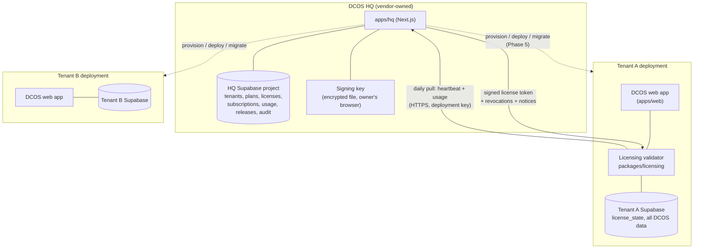
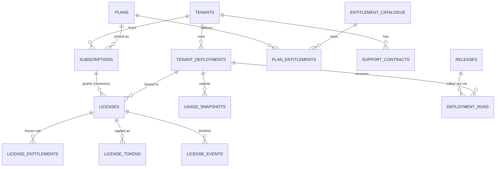
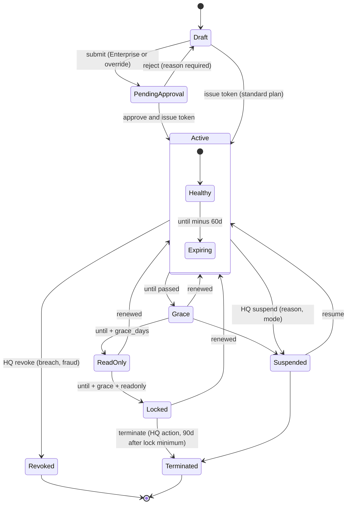

# DCOS Licensing and Control Plane: Review and Design

> **Status:** Draft for owner review, 2026-10-19 · **Author:** System Architect agent · **Owner:** Liheng
> **Input:** the rough sketch in `docs/System Architect key log.md` (Control Plane, DCOS HQ console, Create License, tenant License & Subscription page).
> **Scope:** design only. No code, no migrations, no production changes. Nothing in this document is approved until the owner says so.

## 0. Summary

1. DCOS is **not multi-tenant today**. The local database has one `companies` row, `tenant_id` exists on only 69 of about 440 tables (inventory, procurement and cost-library tables), and 110 of 119 API routes use the service-role key. A shared multi-tenant SaaS would mean retrofitting tenancy into every table. So the sketch's **one database per tenant** is the right call, and it should be a dedicated deployment per customer (own Supabase project, own Vercel deployment).
2. The control plane (**DCOS HQ**) is a **separate application and a separate Supabase project**, never a module inside the customer app. Put it in the monorepo as `apps/hq`, with a small shared `packages/licensing` for the token format and the entitlement catalogue. This is exactly the "second application needs shared types" trigger already written into the Modularisation Plan, Phase 7.
3. A license is an **Ed25519-signed JWS** that the owner signs and the tenant app verifies locally. The private key lives in a **passphrase-encrypted file held by the owner** (decision 6), so a token is signed once per issue, renewal or plan change and is valid for the whole term. The tenant app still checks HQ daily, but only for the latest token and for suspension or revocation notices (HQ never needs inbound access). If HQ is unreachable it keeps working from the last valid token. The same token format also serves a future on-prem install.
4. Licensing is **one new layer** in the existing stack, not a replacement. It sits above Module Settings and release status and below the build-time `DCOS_ENABLED_MODULES`: it can only remove, never add. The tenant admin's Module Settings can hide a licensed module but can never switch on an unlicensed one.
5. Expiry never destroys access to data. The lifecycle is `active → expiring → grace → read-only → locked`, with export and the License page always reachable. All durations are per-license fields with sensible defaults.
6. Enforcement has three levels, built in this order: UI and route guard (cheap, in the MVP), server wrapper on API routes (MVP for seats and projects, then broadened), database triggers (later; they are the only layer that also stops service-role writes and direct PostgREST calls).

---

## 1. Review of the sketch

### 1.1 What is good (keep)

| Item | Why it works |
|---|---|
| Control plane separate from tenant apps | Correct split of concerns: HQ owns commercial truth, tenants own project data. |
| One database per tenant | Matches the codebase reality (see 1.3). Strong data isolation is also a selling point to contractors. |
| "Signed license / entitlements" flowing to a validator inside the tenant app | Right shape. Tenant app enforces locally and does not call HQ on every request. |
| Separating Module Registry, Version Management and Audit in HQ | Matches what a vendor needs: what can be sold, what runs where, who did what. |
| License detail screen: plan, users, expiry, module checklist, feature checklist, actions | Good minimum set. The action row (Renew, Change Plan, Suspend) is the right verb list. |
| Three license types (Trial, Subscription, Enterprise) | Fits the business model. Needs precise definitions (section 3.4). |
| Tenant page shows usage against limits (38 / 50, 7 / 20) | The right transparency; reduces support calls. |

### 1.2 Gaps and risks in the sketch

| # | Gap or risk | Impact | Resolution in this design |
|---|---|---|---|
| G1 | The arrow is one-way (HQ to tenant). No return channel. | HQ cannot show real usage, version, or whether the tenant is alive. "Users 50 / 50" on the HQ screen is ambiguous: limit or usage? | Pull-based heartbeat (section 6). HQ shows limit and last reported usage separately. |
| G2 | "Signed License" is undefined: offline file or online check? | Offline-only means you cannot revoke or change a plan until the token expires. Online-only means an HQ outage takes every customer down. | Hybrid: short-lived token refreshed daily, plus an offline-grace window, plus a long-lived profile for on-prem (section 4). |
| G3 | Clock tampering. | On a self-hosted install the customer controls the clock and can roll it back forever. | Monotonic high-water mark stored in the tenant DB, never moves backwards; HQ `Date` header cross-check on every refresh (section 4.5). |
| G4 | No grace period, no defined expiry behaviour. The traffic light has only green / yellow / red. | Hard lockout on expiry of a construction project system is unacceptable: site teams lose daily reports, IPC data, safety records. A lockout also gives the customer a legal argument. | Five-stage lifecycle with read-only and export-always rules (section 5). |
| G5 | User-count semantics undefined (named vs concurrent, do invited users count, do viewers count, what when over the limit). | The most common source of licensing disputes. | Named seats, invited users reserve a seat, hard block at invite, soft over-limit after a downgrade (section 7.4). |
| G6 | Project limit semantics undefined. DCOS projects include tender-stage projects (`PJR-YYYY-NNN`). | A 20-project limit could be consumed by lost tenders. | Count rule proposed in 7.5; owner decision. |
| G7 | The sketch does not say how entitlements combine with Module Settings (`module_settings`), nav item toggles (`nav_item_settings`), release status (`release.ts`), RBAC, and `DCOS_ENABLED_MODULES`. These are already five independent gates. | Without a defined order, "the admin enabled it but the license says no" becomes a bug report. | Strict resolution order, AND semantics (section 7.1). |
| G8 | The existing route guard runs in the browser (Modularisation Plan, Phase 2: "a release switch, not a security boundary"). 110 API routes use the service role and bypass RLS. | If licensing only reuses the guard, any user who calls an API route or PostgREST directly bypasses it. | Server-side wrapper and DB triggers in later phases (section 7.3). MVP honestly declared as soft enforcement. |
| G9 | The sellable "modules" (Project, Planning, QS, Procurement, Document, HSE, QAQC, Finance, HR) do not map 1:1 to the 12 manifest keys. HSE and QAQC live inside the `construction` manifest; Finance is `account`; Document is `document_control`. Inventory, Design, Reporting are not in the sketch. | A license cannot be enforced at a granularity the code does not have. | Separate **entitlement keys** from manifest keys, with an explicit mapping (section 3.2). |
| G10 | Feature flags (AI Planning, AI QS, Advanced Reports, API Access) have no home in the code. Features today are nav items (`features.ts`), not capabilities. "API Access" has no API surface to gate yet. | Cannot enforce what is not declared. | Entitlement catalogue includes features; code declares which route or action requires which feature (section 7.2). |
| G11 | License number `DCOS-PRO-2027-0001` encodes plan and year. | Plan change or renewal makes the number lie. | Opaque number `DCOS-L-000123`; plan and dates are attributes. |
| G12 | "License" and "Subscription" are used interchangeably in the sketch. | Mixing legal right to use (license) with commercial billing (subscription) makes renewal, proration and credit notes unmodellable. | Separate entities: a **subscription** is the commercial contract and billing cycle; a **license** is the technical grant derived from it. One subscription produces a sequence of licenses (revisions). |
| G13 | "Maintenance" and "Premium Support" appear on the tenant page with a date, but nothing explains them. Under a SaaS subscription maintenance is included. It is only a separate item for perpetual or on-prem enterprise licenses. | Confusing UI and wrong invoices. | Modelled as `support_contracts`, independent of the license end date (section 3.3). Whether a perpetual license exists is an owner decision. |
| G14 | Create License form omits Finance, HR, and all features; the detail screen shows features. Duration is a dropdown only. | Cannot create the license shown in screen 2. | Form expanded in section 9.5. |
| G15 | Module Registry in HQ duplicates the code manifests. | Two sources of truth that drift (the Modularisation Plan already fixed one such drift for `nav-item-catalog.ts`). | HQ catalogue is **generated** from the manifests at release time and published to HQ with the release (section 3.5). |
| G16 | Version Management with one DB per tenant means running up to N copies of 470+ migrations on every release. | This is the largest operating cost of the architecture, not mentioned in the sketch. | Release and deployment tracking, staged rollout rings, migration compatibility window (section 6.4, 10). |
| G17 | No signing key management story. | Leaked private key means every license can be forged forever. | Key held in a passphrase-encrypted file kept offline by the owner (decision 6), `kid` rotation, public keys shipped in the app (section 4.3). |
| G18 | No HQ roles. | Anyone who can open HQ can suspend a customer or grant free modules. | HQ has its own RBAC and four-eyes for risky actions (section 9.1). |
| G19 | Trial abuse and conversion are not modelled. | Repeat trials, trial data lost on conversion. | Trial converts in place (same tenant and DB), one trial per company (section 5.4). |
| G20 | External writers: Telegram attendance bot, Daily Report bot, field app, client programme portal. | In read-only mode these would silently fail for site staff. | Explicit decision on inbound webhooks during read-only (section 5.3 and open decision 12). |

### 1.3 Ground truth from the repository (these constrain the design)

| Finding | Source | Consequence |
|---|---|---|
| One `companies` row, `profiles.company_id` only; `tenant_id` on 69 tables, mostly inventory and cost libraries. | Local DB (read-only query, 2026-10-19) | The system is single-tenant in practice. Note: the architect's standing ADR "RLS tenancy via `tenant_id` from JWT claims" is **not** how the product runs today, and `docs/09-Architecture/ADR/` does not exist in the repo. This document proposes ADRs (section 12). |
| 221 tables allow any signed-in user to read, 224 to insert (`using (true)`); 110 of 119 API routes use the service-role key. | Modularisation Plan, Phase 6 "Permission enforcement: current state" | Shared-DB multi-tenancy is not safely achievable without finishing Phase 6 for all modules. Also means RLS cannot be the licensing enforcement point; triggers can. |
| `DCOS_ENABLED_MODULES` is read in `next.config.ts` and inlined as `NEXT_PUBLIC_DCOS_ENABLED_MODULES` at **build time**. A disabled module leaves the sidebar and hub, pages redirect to `/dashboard`, API routes return 404. | `module-deployment.mjs`, `next.config.ts`, `lib/modules/deployment.ts` | Cannot be used for per-customer licensing on a shared build. Fine as a coarse "edition" ceiling. Also a per-tenant build is needed anyway because `NEXT_PUBLIC_SUPABASE_URL` is inlined at build. |
| `MODULE_REGISTRY` is a static constant filtered by `isModuleDeployed`. Runtime toggles come from `module_settings` (12 keys, admin-only RLS) and `nav_item_settings` (per nav key) passed as a `settings` argument into `isFeatureActive`, `moduleHasActiveFeature`, `isFeatureRouteBlocked`. | `lib/modules/registry.ts`, `features.ts`, migrations `20260720000001`, `20260724000003` | A runtime entitlement layer plugs in as another argument to the same functions. No rewrite of the registry. |
| Release status: `RELEASED` in `release.ts`; a `nav_item_settings` row wins over status. | `lib/modules/release.ts`, `features.ts` | Entitlement must outrank both, otherwise an admin toggle could enable an unlicensed feature. |
| Module manifest has `key`, `rbacModules`, `routePrefixes`, nav groups. `module-boundaries.mjs` `MODULE_PATHS` maps folders (including `app/api/...`) to modules. Construction manifest has rbac codes `construction`, `qa_qc`, `hse`, with nav groups for site, QAQC and HSE. | `manifests/construction.ts`, `module-boundaries.mjs` | `MODULE_PATHS` is already the route-to-module map needed for server-side API enforcement. Sub-module licensing (HSE, QAQC) needs a finer map. |
| `profiles.account_status` has values `ACTIVE`, `INVITED`; `profiles.status` is `active`. User creation goes through `POST /api/admin/users/invite` and `lib/admin-users/admin-users-service.ts`. | Local DB, `app/api/admin/users/invite/route.ts` | Single choke point for seat enforcement at invite time. |
| Administration is never route-blocked ("so a toggle can always be undone"). | Modularisation Plan Phase 2, `roleGoverned: false` | The License page belongs under Administration and inherits this rule: it must stay reachable in every lifecycle state. |
| AI settings tables already exist per project (`plan_act_ai_settings`, `dr_ai_project_settings`). | Local DB table list | Entitlement ("is the tenant allowed to use AI Planning") is separate from setting ("did the project enable it"). Both must be true. |
| Next.js is 16.x with breaking changes; no `middleware.ts` or `proxy.ts` exists today. | `apps/web/CLAUDE.md`, file listing | The backend engineer must read `node_modules/next/dist/docs/` for the current request-interception convention before building the request guard. Not decided here. |
| The workspace already declares `packages/*`. Phase 7 triggers include "a second application needs shared types". | `pnpm-workspace.yaml`, Modularisation Plan Phase 7 | A second app (HQ) is the legitimate trigger to create one small shared package. |

---

## 2. Deployment topology

### 2.1 Options

| | A. SaaS shared (one app, one DB, many tenants) | B. SaaS dedicated (one deployment + one DB per tenant, run by DCOS) | C. On-prem or customer-hosted |
|---|---|---|---|
| Tenant isolation | `tenant_id` + RLS on every table | Physical (separate Supabase project and Vercel deployment) | Physical, customer controls |
| Fit with current code | **Poor.** Needs `tenant_id` on about 370 more tables, rewriting 221 `using (true)` policies, and tenant scoping in 110 service-role routes. Effectively Phase 6 for every module plus a tenancy retrofit. | **Good.** Works today; the app is already single-tenant. | **Good** technically; heavy support burden. |
| Cost per tenant | Lowest | Highest (a Supabase project and deployment each) | Customer pays infra; you pay support |
| Release rollout | One deploy, one migration run | N deploys, N migration runs (needs automation) | Customer-driven; version skew |
| License enforcement trust | Vendor controls everything; enforcement is easy and strong | Vendor controls infra; enforcement is easy; token is mainly a uniform mechanism | Customer controls clock, network and DB; token + clock guard + contract needed |
| Time to first paying customer | Longest | **Shortest** | Medium |
| Noisy neighbour / one bad query | Yes | No | No |
| Data residency / contractor data sovereignty | Hard | Easy (pick region per tenant) | Easy |

### 2.2 Recommendation

**Start with B (SaaS dedicated). Design the license token so C works without changes. Do not build A now.**

Reasons:

1. B is the only option the current codebase supports without a rewrite.
2. The same signed token and tenant-side validator serve B and C; only the token profile (online refresh vs offline long-lived) differs.
3. A can be revisited if the customer count passes a threshold where per-tenant ops cost dominates. By then Phase 6 (database permission enforcement) should be complete, which is the real prerequisite for A.
4. Honest cost: B makes **release management and provisioning automation** the main engineering investment. The sketch's "Version Management / Deployments" boxes are not decoration; they are the price of this choice.



Customer-facing hostnames: one subdomain per tenant (`abc.dcos.example`) pointing at that tenant's Vercel deployment. The HQ also lives on its own domain and its own Vercel project.

---

## 3. Control-plane data model (HQ database)

HQ has its own Supabase project (`dcos-hq`). It is **not** the tenant database and never holds tenant business data. All tables below live in HQ.

**Conventions** (from the architect's rules, with one deliberate exception noted):

- Every table: `id uuid primary key default gen_random_uuid()`, `created_at`, `updated_at`, `created_by uuid references auth.users(id)` (HQ's own auth users).
- Every table that belongs to a customer carries `tenant_id uuid not null references tenants(id)`. Global catalogue tables (`entitlement_catalogue`, `plans`, `plan_entitlements`, `signing_keys`, `releases`) are vendor-scoped and **have no `tenant_id`**. This is an intentional exception to "no exceptions", because there is no meaningful tenant for a catalogue row. Flagged as open decision 17.
- Money: `numeric(18,2)` plus `currency char(3)`. Rounding half-up at line level.
- Status columns: `text` with `CHECK` listing the values in section 5.
- Soft delete via `deleted_at` where the record must stay auditable. `license_events` and `hq_audit_log` are append-only (no UPDATE, no DELETE; same rule as `audit_logs`).
- RLS in HQ: HQ staff only, by `hq_role`. No customer user ever authenticates to HQ in the MVP (customer-facing views are served by the tenant app from the cached token).

### 3.1 Table list

| Table | Purpose | Key columns (beyond the standard ones) |
|---|---|---|
| `tenants` | The customer organisation (the commercial entity). | `code` (unique, short, e.g. `ABC`), `legal_name`, `display_name`, `country`, `billing_email`, `tax_id`, `account_manager_id`, `status` (`prospect, trial, customer, suspended, churned`), `industry_segment`, `notes`, `deleted_at` |
| `tenant_contacts` | People at the customer. | `tenant_id`, `name`, `email`, `phone`, `role` (`billing, technical, license_admin, executive`), `receives_license_notices bool` |
| `tenant_deployments` | One running DCOS instance per tenant (production, plus optional staging). | `tenant_id`, `environment` (`production, staging, demo`), `topology` (`saas_dedicated, on_prem`), `base_url`, `supabase_project_ref`, `region`, `deployment_key_hash` (hash of the heartbeat credential), `app_version`, `schema_version` (latest migration), `last_heartbeat_at`, `last_seen_clock_skew_s`, `status` (`provisioning, healthy, degraded, unreachable, decommissioned`) |
| `entitlement_catalogue` | Everything sellable: modules, features, limits. Global. | `key` (unique, e.g. `module.qs`, `feature.ai_planning`, `limit.users`), `kind` (`module, feature, limit`), `display_name`, `description`, `value_type` (`bool, int, enum`), `manifest_keys text[]` (maps to manifest/module keys), `route_scopes text[]`, `is_base bool` (always included), `sort_order`, `active bool` |
| `plans` | A commercial package. Global. | `code` (`TRIAL, STANDARD, PRO, ENT`), `display_name`, `license_type_default`, `default_duration_months`, `list_price numeric(18,2)`, `price_period` (`monthly, annual, one_time`), `currency`, `active` |
| `plan_entitlements` | Default entitlements of a plan. Global. | `plan_id`, `entitlement_key`, `value jsonb` (`true`, `50`, `"advanced"`) |
| `subscriptions` | The commercial contract. | `tenant_id`, `number` (`SUB-000123`), `plan_id`, `type` (`trial, subscription, enterprise`), `status` (`draft, active, past_due, cancelled, ended`), `start_date`, `current_period_start`, `current_period_end`, `auto_renew bool`, `billing_period`, `net_amount numeric(18,2)`, `currency`, `discount_pct numeric(5,2)`, `po_reference`, `external_billing_ref` (invoice or Stripe id) |
| `licenses` | The technical grant. One row per issued revision; the latest approved row per tenant deployment is "current". | `tenant_id`, `deployment_id`, `subscription_id`, `number` (`DCOS-L-000123`, stable across revisions), `revision int`, `type`, `plan_id`, `status` (`draft, pending_approval, active, suspended, revoked, superseded, expired, terminated`), `valid_from`, `valid_until`, `grace_days int`, `readonly_days int`, `suspend_mode` (`readonly, locked`, nullable), `suspend_reason`, `supersedes_license_id`, `approved_by` |
| `license_entitlements` | Resolved entitlement set for one license revision (plan defaults plus overrides), frozen at issue. | `license_id`, `entitlement_key`, `value jsonb`, `source` (`plan, override, addon`), `override_reason` |
| `license_tokens` | Every signed token ever issued. | `license_id`, `jti` (unique), `kid`, `profile` (`online, offline`), `issued_at`, `expires_at`, `claims jsonb` (copy), `revoked_at`, `revoked_reason`, `delivered_at` (first fetched by tenant) |
| `signing_keys` | Public side of the signing keys. Private key never in a table. | `kid` (unique), `public_key`, `algorithm` (`EdDSA`), `status` (`active, retiring, retired, compromised`), `activated_at`, `retire_after` |
| `support_contracts` | Maintenance and premium support, independent of the license term. | `tenant_id`, `subscription_id` nullable, `tier` (`standard, premium`), `maintenance_until date`, `support_until date`, `sla_response_hours int`, `includes_upgrades bool`, `status` |
| `license_events` | Append-only business timeline for a tenant/license. | `tenant_id`, `license_id`, `event_type` (`created, approved, issued, renewed, plan_changed, entitlement_changed, limit_changed, suspended, resumed, revoked, expired, grace_started, readonly_started, locked, terminated, token_refreshed, over_limit_detected, heartbeat_missed, clock_anomaly`), `payload jsonb`, `actor_id`, `occurred_at` |
| `usage_snapshots` | Daily usage reported by each deployment. | `tenant_id`, `deployment_id`, `snapshot_date`, `active_users`, `invited_users`, `projects_active`, `projects_total`, `storage_bytes bigint`, `module_activity jsonb` (module key to active-user count, last 30 days), `ai_calls_30d int` |
| `heartbeats` | Raw last N heartbeats for diagnostics, pruned after 90 days. | `deployment_id`, `received_at`, `app_version`, `schema_version`, `license_revision_seen`, `observed_state`, `clock_skew_s`, `ip` |
| `releases` | A DCOS version. Global. | `version` (semver), `channel` (`stable, beta, hotfix`), `released_at`, `min_schema`, `max_schema`, `release_notes`, `manifest_snapshot jsonb` (module and feature catalogue from `lib/modules`), `breaking bool`, `status` (`draft, published, withdrawn`) |
| `deployment_runs` | One rollout of a release to one deployment. | `deployment_id`, `release_id`, `ring` (`internal, pilot, general`), `status` (`queued, running, succeeded, failed, rolled_back`), `started_at`, `finished_at`, `migrations_applied int`, `log_url` |
| `notification_rules` | Which events notify whom. | `event_type`, `days_before int` nullable, `audience` (`tenant_admins, tenant_billing, hq_account_manager, hq_ops`), `channel` (`email, in_app, hq_inbox`), `template_key`, `enabled` |
| `notification_outbox` | Queue and history of sent messages. | `tenant_id`, `event_type`, `recipient`, `channel`, `status` (`queued, sent, failed`), `sent_at`, `dedupe_key` (prevents repeat sends) |
| `support_tickets` | Lightweight record linking to the real helpdesk. | `tenant_id`, `subject`, `priority`, `status` (`open, in_progress, waiting_customer, resolved, closed`), `external_ref`, `opened_by_contact_id`, `assigned_to`, `sla_due_at` |
| `hq_users` | HQ staff profile. | `auth_user_id`, `display_name`, `hq_role` (`owner, license_admin, account_manager, support, ops, viewer`), `active` |
| `hq_audit_log` | Append-only audit of every HQ action (includes who viewed a signing action). | `actor_id`, `action`, `entity_type`, `entity_id`, `tenant_id` nullable, `before jsonb`, `after jsonb`, `ip`, `occurred_at` |
| `approval_requests` | Four-eyes approval for risky actions. | `action` (`grant_override, extend_beyond_30d, suspend, revoke, manual_token`), `entity_id`, `requested_by`, `decided_by`, `status` (`pending, approved, rejected`), `reason`, `decision_note` |

Indexes (minimum): `(tenant_id)` on every tenant-owned table; `licenses (deployment_id, status)`, `licenses (valid_until)`, `license_tokens (jti)`, `usage_snapshots (deployment_id, snapshot_date desc)`, `notification_outbox (dedupe_key)` unique, `license_events (tenant_id, occurred_at desc)`.

### 3.2 Entitlement catalogue and mapping to code

Sellable modules and the code they gate. "Manifest key" is `ModuleManifest.key` (= `module_settings.module_key`). The sub-module scope is needed because HSE and QAQC share the `construction` manifest.

| Entitlement key | Sellable name | Manifest key | Scope inside the manifest | RBAC codes (from manifests) | Notes |
|---|---|---|---|---|---|
| `module.project` | Project | `project` | whole | `project` | **Base. Always included**, like `ALWAYS_ON` today. Includes WBS, tasks, stakeholders. |
| `module.planning` | Planning | `planning` | whole, including `app/api/planning`, `app/portal/programme`, WBS look-ahead and Gantt files owned by Planning | `planning` | Client programme portal is public by design; it must still stop serving when Planning is not licensed (decision 13). |
| `module.qs` | QS | `qs` | whole (tenders, contracts, subcontractors, QTO) | `qs`, `tender` | |
| `module.procurement` | Procurement | `procurement` | whole | `procurement` | Inventory is a separate manifest; see decision 4. |
| `module.document` | Document | `document_control` | whole | `document_control` | |
| `module.hse` | HSE | `construction` | `/dashboard/hse`, HSE nav group | `hse` | Needs a sub-scope map, not just a manifest key. |
| `module.qaqc` | QAQC | `construction` | `/dashboard/qaqc`, QAQC nav group | `qa_qc` | Same. |
| `module.finance` | Finance | `account` | whole | `account_finance` | |
| `module.hr` | HR | `hr` | whole including Telegram attendance routes | `hr` | |
| `module.construction` | Site (daily reports) | `construction` | `/dashboard/site`, `app/api/dr`, `app/field`, `app/dr-miniapp` | `construction` | **Not in the sketch.** Proposed as part of the base or Planning bundle (decision 4). |
| `module.inventory` | Inventory | `inventory` | whole | (see manifest) | **Not in the sketch.** Decision 4. |
| `module.design` | Design / BIM | `design` | whole | none today | **Not in the sketch.** Decision 4. |
| `module.reporting` | Reporting | `reporting` | whole | `reporting_kpi` | **Not in the sketch.** Likely folded into `feature.advanced_reports`. |
| (platform) | Administration | `administration` | whole | | **Never licensable.** Always on, like today. |
| `feature.ai_planning` | AI Planning | | Planning AI endpoints and UI | | Entitlement is the right; `plan_act_ai_settings` stays the per-project choice. |
| `feature.ai_qs` | AI QS | | QS AI endpoints and UI | | |
| `feature.advanced_reports` | Advanced Reports | | report-kit exports and advanced reporting pages (a list to be curated) | | |
| `feature.api_access` | API Access | | **A public API does not exist yet.** Needs its own design: API keys, rate limits, scopes. | | Sell only after that exists. |
| `limit.users` | Named users | | full seat count | | int; `null` means unlimited |
| `limit.viewers` | Viewer users | | read-only seat count, priced lower (decision 3) | | int; `0` means no viewer seats; `null` unlimited |
| `limit.projects` | Active projects | | project count | | int |
| `limit.storage_gb` | Storage | | Supabase storage | | optional; soft limit, reporting only in MVP |
| `limit.ai_calls_month` | AI calls per month | | AI metering | | optional, only if AI cost needs capping (decision 9) |
| `support.tier` | Support tier | | | | enum `standard, premium`; display and SLA only, never access control |

How the mapping is kept in the code (section 7.2): the manifest gains an optional `entitlement` per module and per nav group; `module-boundaries.mjs` gains an `ENTITLEMENT_PATHS` map for sub-module route scopes (HSE, QAQC, Site). HQ's catalogue is generated from these, not typed by hand.

### 3.3 Subscription, license, support relationship



Rules:

- A plan change, add-on, limit change or renewal creates a **new license revision** (`revision + 1`, same `number`) that supersedes the previous one. Nothing is edited in place; history stays reconstructable.
- Support contracts are independent: a tenant can have an active subscription and an expired premium support, and the tenant page shows both dates (as in the sketch).

### 3.4 License types defined precisely

| Type | Purpose | Term | Default behaviour |
|---|---|---|---|
| **Trial** | Evaluation by a prospect | 30 days (14 to 60 configurable), one per company | Limited seats and projects from the `TRIAL` plan; converts in place to a paid license (same deployment and data); no grace; short read-only window for export. |
| **Subscription** | Standard recurring plan | Monthly or annual, auto-renew optional | Entitlements from the plan, optional overrides; full lifecycle of section 5. |
| **Enterprise** | Negotiated contract | Custom; may be multi-year; may be perpetual with maintenance (decision 5) | Custom limits and features, custom grace and read-only durations, optional on-prem profile, requires approval to issue (four-eyes). |

### 3.5 Module Registry and Version Management in HQ

- **Module registry = generated, not authored.** The release pipeline publishes `manifest_snapshot` (module keys, nav groups, features, entitlement keys) to `releases`. HQ shows "which modules and features exist in version X". The `entitlement_catalogue` is synchronised from the newest published snapshot; a new module becomes sellable only after a release that contains it. This avoids a second source of truth.
- **Release states** are `draft, published, withdrawn`. Each tenant deployment stores `app_version` and `schema_version`, so HQ can answer "who is still on the old version" and block a license revision that grants a module the deployed version does not contain.

---

## 4. License token

### 4.1 Format

A JWS (compact serialisation), algorithm **EdDSA (Ed25519)**. Chosen because: small signatures, fast verification, no parameter pitfalls like RSA padding, and supported by WebCrypto and Node, so the same verifier can run in the request guard and in server code. The token is a JWT-style claims set but is **not** an access token and must never be sent to browsers other than as a display-safe summary.

Header:

```json
{ "alg": "EdDSA", "typ": "dcos-license+jwt", "kid": "hq-2026-01" }
```

Claims (illustrative; field names are the contract, to be frozen in `packages/licensing`):

```json
{
  "iss": "https://hq.dcos.example",
  "sub": "tnt_8f3c...",                 // HQ tenant id
  "aud": "dep_51ab...",                 // deployment id: token is useless on another deployment
  "jti": "lt_2027_000345",              // token id, unique
  "iat": 1798761600,
  "nbf": 1798761600,
  "exp": 1799366400,                    // until + grace + read-only + 30 days (section 4.2)
  "prof": "online",                     // online | offline
  "lic": {
    "id": "DCOS-L-000123",
    "rev": 4,                           // never accept a lower rev than already stored
    "type": "subscription",             // trial | subscription | enterprise
    "plan": "PRO",
    "from": "2027-01-01",
    "until": "2027-12-31",
    "grace_days": 14,
    "readonly_days": 30,
    "hq_state": "active",               // active | suspended | revoked
    "suspend_mode": null,               // readonly | locked, when hq_state = suspended
    "notice": null                      // optional short message shown to tenant admins
  },
  "ent": {
    "modules": ["project","planning","qs","procurement","document_control"],
    "features": ["ai_planning","ai_qs","advanced_reports"],
    "limits": { "users": 50, "projects": 20, "storage_gb": 100 }
  },
  "support": { "tier": "premium", "maintenance_until": "2027-12-31", "support_until": "2027-12-31" },
  "min_app": "2.4.0",
  "refresh_after": 1798848000           // when the tenant should try to refresh (online profile)
}
```

Module identifiers in `ent.modules` use **entitlement keys** (section 3.2) without the `module.` prefix, so `hse` and `qaqc` can be expressed even though they share a manifest.

### 4.2 Token profiles

Because the signing key is an encrypted file that only the owner unlocks (decision 6, decided), HQ cannot sign unattended. Tokens are therefore **long-lived (one per term)**, and short-term control comes from a separate, unsigned **status feed** that can only reduce access.

| | Online (SaaS dedicated, default) | Offline (on-prem or air-gapped) |
|---|---|---|
| `exp` | `until + grace_days + readonly_days + 30` (same as offline) | `until + grace_days + readonly_days + 30` |
| When a token is signed | On issue, renewal, plan change or seat/project change: the owner unlocks the key and signs (section 4.3) | Same |
| Refresh | Tenant pulls daily: latest token revision (if any) plus the status feed | Manual: HQ issues a new file, tenant admin uploads it on the License page |
| Status feed | The daily heartbeat response (section 6.2) over TLS, authenticated with `DCOS_DEPLOYMENT_KEY`. Carries `{suspended, suspend_mode, revoked_jtis[], compromised_kids[], server_time}`. Not signed: it can only **lower** access (suspend, revoke), never raise it, so a forged feed cannot unlock anything. Raising access always needs a new signed token. | Not available; suspension is contractual |
| Revocation / suspension latency | Up to 24 hours | Only on next upload (contractual) |
| If HQ unreachable | Keep working from the last valid token and the last status seen. After 14 days without contact show a "license unverified" banner to admins only. No lockout, because the signed dates still govern. | Not applicable |

### 4.3 Keys and rotation

- **Custody (decision 6, decided: encrypted file).** The Ed25519 private key is stored as a passphrase-encrypted file, `dcos-signing-<kid>.key.json`: a JSON envelope `{kid, alg: "Ed25519", kdf: "scrypt", N, r, p, salt, iv, ciphertext}`, where the PKCS#8 key is encrypted with AES-256-GCM using a key derived from the passphrase by scrypt (N ≥ 2^17). The file is never in the repo, env vars, the HQ database or HQ storage.
- **Where signing happens.** In Phase 1 the owner signs with `scripts/licensing/issue-license.mjs --key <file>` (prompts for the passphrase). In Phase 2 HQ signs **in the owner's browser**: HQ prepares the claims, the owner picks the key file and types the passphrase, WebCrypto decrypts and signs in memory, and only the signed token is sent to HQ. The key never reaches the HQ server. The CLI stays as a fallback. Every signature is an audited action (`hq_audit_log`: who, kid, jti, claims hash).
- **Backups.** Two copies of the encrypted file offline (for example an encrypted USB drive in a safe and a password manager attachment). The passphrase is stored separately from both. Losing the file and passphrase means rotating to a new key and shipping an app release with the new public key. Old tokens keep working until they expire.
- **Key generation.** `scripts/licensing/new-signing-key.mjs` creates the key pair, writes the encrypted file and prints the public key and `kid` to add to `packages/licensing/keys.json`.
- Public keys are shipped **only in the app build** (`packages/licensing/keys.json`: list of `{kid, publicKey, notBefore, notAfter}`). HQ never sends trusted keys over the heartbeat, because the heartbeat is unsigned and adding a key would raise access. It may only mark a known `kid` as compromised.
- Rotation: generate new key, publish `kid` as `active` while the old is `retiring`, issue all new tokens with the new `kid`, ship an app release containing both public keys **before** the first token with the new kid is issued, retire the old key after the longest outstanding offline token expires. Compromise: mark `compromised`; the next heartbeat response carries a revocation notice and the tenant rejects any token with that `kid`; on-prem customers get an emergency app update and a replacement token.
- Tenant accepts a token only if: signature valid for a known `kid`; `aud` equals its own deployment id; `nbf <= now`; `lic.rev >= stored rev`; `jti` not on the revocation list and `kid` not marked compromised (both from the status feed). `exp` expiry is handled per profile above, not as a hard reject.

### 4.4 Binding the token to the deployment

The deployment id and a **deployment key** are created when HQ provisions the deployment and are set as server-only environment variables on the tenant (`DCOS_DEPLOYMENT_ID`, `DCOS_DEPLOYMENT_KEY`; the second never appears in client code). A copied token fails the `aud` check on any other deployment. For on-prem the `aud` is a customer-supplied install id that the tenant app displays and the customer reports back when requesting a license.

### 4.5 Clock tampering

1. The tenant keeps `high_water_at` in the DB (the greatest "now" it has ever seen, updated at most once a minute and on every refresh).
2. Effective time for all license decisions is `max(system_now, high_water_at)`. Rolling the clock back changes nothing.
3. Each HQ response includes a `Date`; if the skew exceeds 24 hours the deployment records `clock_anomaly` and reports it in the next heartbeat.
4. If the system clock is ahead of HQ by more than a day, the app caps `high_water_at` at HQ's `server_time`. This stops a one-off clock jump forward from permanently expiring the license (the high-water mark would otherwise never come back down).
5. For SaaS dedicated, the vendor controls the server clock, so this matters mostly for on-prem. It is cheap, so it ships in the MVP anyway.

---

## 5. Lifecycle state machine

### 5.1 States

Two kinds of state, to keep the tenant working offline:

- **Stored (decided by HQ, carried in the token as `lic.hq_state`)**: `draft`, `active`, `suspended`, `revoked`, `terminated`.
- **Derived (computed by the tenant from dates and the current time)**: `expiring`, `grace`, `readonly`, `locked`. These need no HQ contact, so they behave correctly even if HQ is down.



"Renewed" is an **event**, not a state: it issues a new license revision with a later `valid_until`, and the machine returns to `Active`. Upgrading, adding modules, or changing limits are also new revisions without leaving `Active`.

### 5.2 Timeline (defaults for a Subscription; Enterprise values come from the contract)

```
         T-60d          T-14d             T0 (valid_until)      T+14d            T+44d
 ──────────┬──────────────┬──────────────────┬─────────────────────┬────────────────┬──────────►
  ACTIVE   │  EXPIRING    │  EXPIRING        │  GRACE              │  READ-ONLY     │  LOCKED
           │  admin banner│  all-user banner │  full function      │  no writes     │  admin-only +
           │  + email     │  + email         │  red banner         │  export OK     │  export + renew
```

Trial: `T0` = trial end; no grace; read-only 7 days; then locked.

### 5.3 Exact behaviour per state

| Capability | Active | Expiring | Grace | Read-only | Locked | Suspended (readonly) | Suspended (locked) | Terminated |
|---|---|---|---|---|---|---|---|---|
| Sign in | Yes | Yes | Yes | Yes | **Admins and License admins only** | Yes | Admins only | Admins only |
| Read data of licensed modules | Yes | Yes | Yes | Yes | No (except export) | Yes | No (except export) | No |
| Create / edit / delete / approve | Yes | Yes | Yes | **No** | No | **No** | No | No |
| Create new project | Yes (within limit) | Yes | Yes | No | No | No | No | No |
| Invite or activate users | Yes (within limit) | Yes | Yes | No | No | No | No | No |
| Existing users keep working | Yes | Yes | Yes | Read only | No | Read only | No | No |
| AI features | Per entitlement | Yes | Yes | No | No | No | No | No |
| Export / print own data (CSV, PDF, BOQ, IPC) | Yes | Yes | Yes | **Yes** | **Yes** (admin) | Yes | Yes (admin) | Yes (admin, time-limited) |
| License & Subscription page, renew request, contact support | Yes | Yes | Yes | Yes | Yes | Yes | Yes | Yes |
| Password change / sign out | Yes | Yes | Yes | Yes | Yes | Yes | Yes | Yes |
| Banner | None | Info (admins from T-60, all users from T-14) | Warning, all users | Danger, all users | Full-page notice | Danger, shows HQ notice | Full-page notice | Full-page notice |
| Data retained | Yes | Yes | Yes | Yes | Yes | Yes | Yes | **Policy-driven**: retained 90 days after termination, then archived or deleted only on written instruction (decision 11) |
| HQ heartbeat continues | Yes | Yes | Yes | Yes | Yes | Yes | Yes | Yes |

Principles that hold in every state:

1. **No data destruction on expiry.** Deletion only follows an explicit, audited terminate action and the retention policy.
2. **Export is always possible** for admins, so a lapsed customer is never held hostage. This is also the commercial argument for the grace design.
3. **Administration and the License page are never blocked** (same rule as `roleGoverned: false` today).
4. **Read-only is enforced as "reject non-GET methods on application routes" plus DB write guards**, with a short allow-list: auth, password change, license refresh, export endpoints, heartbeat.
5. **Inbound webhooks** (Telegram attendance bot, Daily Report bot, field app sync): in read-only they would be rejected, which silently loses site data. Recommendation: allow site-data ingestion (attendance, daily reports) during **grace and read-only**, queue-and-reject only in **locked**, and show the admin a count of rejected inbound items. Owner decision 12.
6. Over-limit is **not** a lifecycle state. It is a separate condition (section 7.4) that blocks creation but never access.

### 5.4 Transitions: who and what

| From | To | Trigger | Actor | Emits audit event | Rejection / failure path |
|---|---|---|---|---|---|
| Draft | Active | Issue license (standard plan, no overrides) | `license_admin` | `license_events.issued`, `hq_audit_log` | Validation fails (e.g. tenant has no deployment, module not in target release): form shows reasons, stays Draft. |
| Draft | PendingApproval | Submit (Enterprise, overrides, > 30-day extension) | `license_admin` | `created` | |
| PendingApproval | Active | Approve | `owner` (not the requester) | `approved`, `issued` | |
| PendingApproval | Draft | Reject | `owner` | `rejected` with reason | Requester notified; edits and resubmits. |
| Active | Grace / Read-only / Locked | Time passes `valid_until` | System (derived on tenant; HQ cron records the event) | `grace_started`, `readonly_started`, `locked` | None; cannot be skipped. |
| Grace / Read-only / Locked | Active | Renewal revision issued | `license_admin` / auto-renew job | `renewed` | If renewal needs approval and is rejected, state stays; tenant sees "renewal pending". |
| Active / Grace | Suspended | Suspend (mode, reason mandatory) | `license_admin` + approval | `suspended` | Rejected approval: stays Active. |
| Suspended | Active | Resume | `license_admin` | `resumed` | |
| Any | Revoked | Revoke (breach, fraud) | `owner` + approval | `revoked` | Tenant treated as Locked immediately via revocation list. |
| Locked / Suspended | Terminated | Terminate | `owner` + approval, minimum 90 days after lock | `terminated` | Rejected: stays Locked. |
| Trial Active | Subscription Active | Convert | `account_manager` / `license_admin` | `plan_changed` | Same deployment and data; new revision; trial limits replaced. |

Trial rules: one trial per `tenants.tax_id` / legal entity; a trial deployment is a normal deployment with `tenants.status = trial`; conversion changes the license revision, not the data.

---

## 6. Tenant sync, telemetry and release tracking

### 6.1 Tenant-side storage (inside each tenant database)

New objects, designed here, written by the database-engineer later:

| Table | Purpose | Key columns |
|---|---|---|
| `license_state` (single row) | Cached license and local state. | `hq_tenant_id`, `deployment_id`, `token` (the JWS), `claims jsonb` (verified, parsed), `lic_rev`, `token_kid`, `token_exp`, `last_refresh_ok_at`, `last_refresh_error`, `high_water_at`, `revoked_jtis text[]`, `compromised_kids text[]`, `suspended`, `suspend_mode`, `updated_at` |
| `license_local_events` | Append-only local timeline (refresh ok/failed, state changes observed, over-limit attempts, rejected calls summary). | `event_type`, `payload`, `occurred_at`, `actor_id` |
| `license_state_view` (SQL view or function `license_effective()`) | Used by DB triggers (later phase) to read mode quickly. | `mode` (`full, readonly, locked`), `as_of` |

The tenant DB does not follow the `tenant_id` rule for these (single-tenant deployment); `hq_tenant_id` is stored for reference. Tenant admin can read `license_state` through a server route; the token column is never selectable from the browser (RLS: no direct client access, service role through the licensing module only).

### 6.2 Sync protocol (pull)

```mermaid
sequenceDiagram
  participant T as Tenant app (server job, daily + on admin "Refresh now")
  participant H as HQ API
  T->>H: POST /api/v1/deployments/{id}/heartbeat<br/>Authorization: deployment key<br/>{app_version, schema_version, lic_rev, observed_state, usage, clock}
  H-->>T: 200 {token?, suspended, suspend_mode, revoked_jtis, compromised_kids, notices, min_app, server_time}
  T->>T: verify signature, aud, rev, nbf; compare Date header to clock
  T->>T: store token, update high_water_at
  Note over T,H: On failure: keep last token, log local event, retry with backoff;<br/>signed token dates keep governing
```

Rules:

- Tenant initiates every call (works behind customer firewalls; no inbound hole).
- Credential: per-deployment secret (hashed in HQ), rotatable. HMAC-signed request body is an acceptable alternative to a bearer secret.
- On Vercel, the "daily job" is a Vercel Cron hitting an internal route in the tenant app, plus an opportunistic refresh when an admin opens the License page and the token is older than 24 hours.
- HQ may also change the license between refreshes (e.g. suspend): the tenant picks it up within 24 hours. For urgent revocation HQ may call a tenant endpoint (`POST /api/licensing/hq-ping`, signed by HQ) to trigger an immediate refresh; failure of this ping is non-fatal.

### 6.3 Telemetry: what is sent and what is never sent

| Sent (per day) | Never sent |
|---|---|
| App version, schema version, license revision seen, observed state | Project names, WBS content, BOQ rates, any financial amounts |
| Counts: active users, invited users, projects (active/total), storage bytes | Employee names, emails, payroll or HR data |
| Per module: number of distinct active users in last 30 days | Documents or file names |
| AI calls count (if metered) | Free-text fields of any kind |
| Clock skew | IP addresses of end users |

This must be stated in the customer contract and visible to the tenant admin on the License page ("What DCOS reports"). It also keeps the privacy posture simple for HR and payroll data already in the system.

### 6.4 Releases and deployments

- A release is published to HQ by CI (version, manifest snapshot, migration range, `breaking` flag).
- Rollout rings: `internal` (DCOS's own deployment), `pilot` (volunteer tenants), `general`. HQ's Deployments screen starts a run per deployment: build/redeploy, run migrations, verify, record. Failure sets `rolled_back` and keeps the tenant on the old version.
- **Compatibility window**: app version N must run against schema N and N-1 so that a rolling rollout does not strand tenants mid-way. Migrations remain additive-only (already a rule in Modularisation Phase 4).
- HQ refuses to issue a license revision with a module/feature that the deployment's current `app_version` does not contain, and shows "upgrade required" instead.

### 6.5 Audit and notifications

**Audit.** Two layers, both append-only:

- HQ: `hq_audit_log` for every action by staff (create/approve/issue/suspend/revoke/resume, key operations, viewing a secret) and `license_events` per license.
- Tenant: `license_local_events`, surfaced to tenant admins in Administration > Audit Logs (existing page, `components/administration/audit-log-page.tsx`). License-affecting tenant actions (refresh, seat claim, over-limit block, upload of offline token) emit an audit event.

**Notifications.**

| Event | Audience | Channel | Timing |
|---|---|---|---|
| Expiring | Tenant license admins and billing contact | Email + in-app banner (admins) | T-60, T-30, T-14, T-7, T-1 |
| Expiring | All tenant users | In-app banner | from T-14 |
| Expired, grace started | Admins + billing; HQ account manager | Email + banner (all) | T0 |
| Read-only started / Locked | Same + HQ ops | Email + banner | on transition |
| Suspended / resumed / revoked | Tenant admins + billing; HQ owner | Email + banner | immediate |
| Seat or project limit reached (90%, 100%) | Tenant admins | In-app, email at 100% | when crossed |
| Over limit after downgrade | Tenant admins, HQ account manager | Email | daily until resolved, max 7 |
| Heartbeat missed 3 days / 7 days | HQ ops, then account manager | HQ inbox + email | |
| Clock anomaly, token rejected, bad signature | HQ ops | HQ inbox | immediate |
| Renewal approved / issued | Tenant admins | Email | immediate |

De-duplicated with `notification_outbox.dedupe_key` (e.g. `exp-60-<license>-<rev>`). Use the existing email path (Supabase Auth mail / project SMTP). The Telegram bots stay out of license notices.

---

## 7. Tenant-side enforcement

### 7.1 Entitlement resolution order

A user can use something only if **every** layer allows it (logical AND). Order of evaluation, outermost first:

| # | Layer | Source | Granularity | Can add rights? | Existing or new |
|---|---|---|---|---|---|
| 0 | **Build ceiling** | `DCOS_ENABLED_MODULES` (build time, inlined) | module | No, only removes | Existing. Keep for stripped editions. For normal SaaS leave unset (`all`). |
| 1 | **License entitlement** | signed token `ent.modules / features / limits` and lifecycle mode | module, sub-module, feature, limit, mode | **Defines the maximum** | **New** |
| 2 | **Release status** | `release.ts` `RELEASED`, manifest `status` | nav group / page | No | Existing |
| 3 | **Tenant admin toggles** | `module_settings`, `nav_item_settings` row (a row wins over release status, as today) | module, nav item | Only within what layers 0-1 allow | Existing |
| 4 | **RBAC** | `roles`, `role_permissions`, `has_permission(...)` | per role, per action | No | Existing |
| 5 | **Action quotas** | seat and project counters | create user, create project | No | **New** |
| 6 | **Lifecycle mode overlay** | derived state | all writes | No | **New** (part of layer 1 logic) |

Notes on the order:

- Layer 1 must outrank layers 2 and 3 because a `nav_item_settings` row can currently enable a "development" feature. A license must not be bypassable by a toggle row.
- Layer 2 (release) stays below the license: licensing says "you may use QS"; release status says "this particular page of QS is not ready". Both must pass.
- Layer 3 is the tenant's own preference. An unlicensed module is shown to admins in Module Settings as locked, with a "Not in your plan" label and the toggle disabled.
- Layer 0 is a deployment property. A module that is off here is also invisible in the License page's "available" list, because the code is not offered.

Truth table examples:

| Build | License | Release | Module Settings | RBAC | Result |
|---|---|---|---|---|---|
| all | QS yes | released | on | permitted | Visible, usable |
| all | QS **no** | released | on | permitted | Hidden; direct URL redirects to a "Not in your plan" page; API returns `LIC_MODULE_NOT_LICENSED` |
| all | QS yes | development page | on, no row | permitted | Hidden (release status), as today |
| all | QS yes | development page | row `is_active = true` | permitted | Visible (the existing admin override still works) |
| all | QS **no** | development page | row `is_active = true` | permitted | **Hidden** (license wins over the row) |
| `qs,planning` only | HR yes | n/a | n/a | n/a | Hidden and route 404 (code not offered); License page marks HR as "not available in this build" |
| all | QS yes | released | **off** | permitted | Hidden by the tenant admin's choice; seat still counted; page redirects |

### 7.2 How the code declares what needs what

Design only; backend and frontend engineers implement.

1. `ModuleManifest` gains an optional `entitlement` (key from section 3.2). Nav groups and leaves may declare a finer `entitlement` (so `hse` and `qaqc` groups inside `construction` map to `module.hse` and `module.qaqc`). A manifest without an entitlement uses `module.<key>`.
2. Features: a short declarative list in `packages/licensing/catalogue.ts` maps each `feature.*` key to the route prefixes, server actions and UI components it governs (e.g. `feature.ai_planning` governs the Planning AI endpoints). Code that renders an AI button checks `useEntitlement("feature.ai_planning")`.
3. `module-boundaries.mjs` gains `ENTITLEMENT_PATHS` for sub-module route scopes (`app/dashboard/hse`, `app/dashboard/qaqc`, `app/dashboard/site`, `app/api/dr`). `MODULE_PATHS` is reused as the default route-to-entitlement map for every other module, so an API route under `app/api/planning` is attributed to `module.planning` with no extra work.
4. A unit test (in the style of `lib/modules/__tests__/boundaries.test.ts`) asserts that every manifest, route folder and catalogue key map consistently, and that every API route folder is attributed to an entitlement or to core. This stops silent drift.

### 7.3 Enforcement points

| # | Point | What it does | Strength | Phase |
|---|---|---|---|---|
| E1 | **Licensing core** (`lib/licensing/*`, server-only): load `license_state`, verify token, compute `effective(now)` → `{state, mode, modules, features, limits, notices}`; in-memory cache 60 seconds. | Single source of truth for all other points. Fails safe: on corrupted/missing token, behave per `DCOS_LICENSE_MODE` (see below). | n/a | MVP |
| E2 | **Request guard** (the Next.js 16 request-interception file; check `node_modules/next/dist/docs/` for the current name and runtime). For `/dashboard/*` pages: if the path's entitlement is not licensed, redirect to `/dashboard/license/not-in-plan`; if mode is locked, redirect non-admins to the lock page. For `/api/*`: 403 `LIC_*` JSON. | Server-side, before any page code. Replaces "browser-only guard" for licensing. | Medium (UI and API level) | MVP |
| E3 | **API wrapper** `withLicense({ entitlement?, feature?, write: true })` applied in route handlers, resolving the entitlement from `MODULE_PATHS` by default. Rejects writes in read-only/locked mode, and any call to an unlicensed module/feature. | Needed because many routes use the service role and RLS cannot help. Starts with: user invite, project create, all `app/api/hr`, `app/api/tenders`, `app/api/planning`, `app/api/dr`, `app/api/inv`, `app/api/bim`. | Medium-high | MVP for seats and projects; rest in P4 |
| E4 | **UI**: `useEntitlements()` context (like the existing module settings provider) feeds sidebar, module hub, Module Settings, buttons. `isFeatureActive(...)` and `moduleHasActiveFeature(...)` take the entitlement set as an extra argument. Locked modules appear in the hub as "Not in your plan" cards with a request link (admins only; others see nothing). | Cosmetic and UX; not a security boundary. | Low | MVP |
| E5 | **Database write guard** (trigger): a generic `before insert or update or delete` trigger, attached by migration to each module's anchor tables (and to `projects` and `profiles` for quotas), which raises `LIC_READ_ONLY` / `LIC_MODULE_NOT_LICENSED` / `LIC_SEAT_LIMIT` / `LIC_PROJECT_LIMIT` based on `license_effective()`. | The only layer that also stops **service-role** writes and direct PostgREST calls. RLS cannot be used for this because service role bypasses it and most policies are `using (true)`. A table-to-module registry (generated from `MODULE_PATHS` and a table list) drives which triggers are attached. | **High** | P4 |
| E6 | **Seat claim** (atomic): a DB function `license_claim_seat(user_id)` called in the invite transaction, with an advisory lock, so two concurrent invites cannot both take the last seat. Plus the E5 trigger on `profiles` as backstop. | Correctness under concurrency. | High | MVP (function), P4 (trigger) |
| E7 | **Project quota check** inside the project create path, also a trigger backstop (E5). | | High | MVP check, P4 trigger |

**Unlicensed / unverified behaviour (`DCOS_LICENSE_MODE`)**. Critical for not breaking today's environments:

| Mode | Meaning | Used where |
|---|---|---|
| `off` | Licensing disabled; everything allowed, no banners. | Local development, the owner's current deployment until a license is issued, CI. |
| `enforce` | Normal. No valid token means `locked` after the offline grace. | All customer deployments. |
| `report` | Evaluate and log would-be denials but allow. | Rollout of enforcement per tenant (shadow mode); first week of each phase. |

Honest statement of the MVP: in P1-P3 a determined user with the anon key could still call PostgREST for an unlicensed module's tables, because RLS there is `using (true)`. For SaaS dedicated this is a contractual risk, not a platform risk (the customer cannot modify the code or infrastructure), and E5 in P4 closes it. This should be accepted knowingly (decision 8).

### 7.4 Seat (user-count) semantics

| Rule | Proposal |
|---|---|
| What is a seat | One **named** user: a `profiles` row whose `account_status` is `ACTIVE` or `INVITED` and which is not flagged as a service/system account. No concurrent-user licensing. |
| Invited users | **Count** (the seat is reserved at invite). Invites that expire or are revoked release the seat. Prevents inviting 500 people and activating them later. |
| Deactivated / suspended users | Free the seat. Reactivation re-checks the limit. |
| Viewers | **Decided (decision 3): a separate, cheaper seat class**, `limit.viewers`. A viewer is a user whose roles grant read-only permissions only (no create/update/delete/approve in any module). Viewers draw from `limit.viewers`, everyone else from `limit.users`. Giving a viewer any write permission moves them to a full seat, so the role change runs the full-seat check and is refused with `LIC_SEAT_LIMIT` if none is free. The invite dialog and License page show both counts, e.g. `Users 38 / 50 · Viewers 12 / 30`. |
| Admins and HQ support access | Admins count. A temporary support login created by HQ does not count and is time-boxed and audited. |
| Client programme portal (public) | Not a seat; no login. |
| At the limit | `POST /api/admin/users/invite` and "reactivate" return 403 `LIC_SEAT_LIMIT` with `{used, limit}`; the invite dialog shows `38 / 50` and disables Send at the limit, with a "Request more seats" link. |
| Over the limit after a downgrade or renewal at a lower number | **Soft over-limit**: nobody is deactivated, nothing locks. New invites and reactivations are blocked until under the limit. Admin sees an over-limit banner with the number to remove. After 30 days over limit: notification to HQ account manager (commercial conversation, not a technical lockout). |
| Race condition | Seat claim is atomic (E6). |
| Counting source of truth | The tenant DB. HQ shows the last reported figure with its timestamp. |

### 7.5 Project-limit semantics (decided, decision 2)

A **project** counts toward `limit.projects` when it is **not** archived/cancelled/completed-and-closed. Tender-stage projects (pre-contract, code `PJR-YYYY-NNN`) do **not** count until awarded, so a QS team can bid freely. On award (converted in place, per the Pre-contract lifecycle) they start to count; if the award would exceed the limit, the award still succeeds and the tenant goes soft over-limit (an award is a business event that must not be blocked by licensing). Enforcement: project create returns 403 `LIC_PROJECT_LIMIT` with `{used, limit}`. Over-limit semantics identical to seats.

### 7.6 Error contract

Same shape the API already uses (`{ error, code }`), HTTP 403 (402 is rarely understood by clients), stable codes:

| Code | When |
|---|---|
| `LIC_MODULE_NOT_LICENSED` | Route or action belongs to a module not in `ent.modules` |
| `LIC_FEATURE_NOT_LICENSED` | Feature flag not granted |
| `LIC_SEAT_LIMIT` | Invite/reactivate over `limit.users` |
| `LIC_PROJECT_LIMIT` | Create over `limit.projects` |
| `LIC_READ_ONLY` | Write attempted in grace-ended read-only or suspended-readonly mode |
| `LIC_LOCKED` | Any non-allow-listed call in locked mode |
| `LIC_SUSPENDED` | HQ suspension; message from `lic.notice` |
| `LIC_UNVERIFIED` | Token missing/invalid and offline grace exhausted |

The response also carries `{ used, limit, upgrade_url }` where relevant so the UI can render the right banner.

---

## 8. Over-limit, grace and renewal behaviours (quick reference)

| Situation | Behaviour |
|---|---|
| Seat limit reached | Invite blocked; existing users unaffected. |
| Project limit reached | Create blocked; existing projects fully editable. |
| Downgrade to fewer seats than used | Soft over-limit (7.4). |
| Downgrade removes a module that has data | Module becomes read-only for existing data (view and export) for 90 days, then hidden but data retained; re-adding the module restores it. Data is **never** deleted by a plan change. Owner confirm (decision 10). |
| Upgrade (add module / raise limits) | New revision, effective on next refresh; admin can press "Refresh license now" for immediate effect. |
| Renewal while in grace/read-only/locked | New revision with `valid_from` equal to the old `valid_until` (no gap billing unless contractually required), state returns to Active immediately. |
| HQ unreachable | Signed token dates govern; after 14 days without contact show an "unverified" banner to admins. No extra lockout. |
| Trial end | Read-only 7 days with export, then locked; HQ account manager notified at T-7, T-1, T0. |

---

## 9. Screens

### 9.1 DCOS HQ console

**Placement and access.** Separate app `apps/hq`, own Vercel project, own Supabase project/auth, SSO or email+password with mandatory MFA, IP allow-list optional. HQ roles:

| Role | Can |
|---|---|
| `owner` | Everything, approves risky actions, manages keys and HQ users |
| `license_admin` | Create, issue, renew, change plan, suspend (with approval), resume |
| `account_manager` | Manage tenants, contacts, subscriptions, trials; view licenses; request actions |
| `support` | View tenants, licenses, usage, tickets; trigger "refresh now"; create time-boxed support access |
| `ops` | Releases, deployments, provisioning, heartbeats |
| `viewer` | Read only |

Four-eyes (approval by a different `owner`) for: Enterprise license issue, any override of plan entitlements, extension > 30 days, suspend, revoke, terminate, manual token download.

Navigation (the sketch's list, expanded): Dashboard · Tenants · Onboarding · Licenses · Subscriptions · Plans & Catalogue · Usage · Releases · Deployments · Support · Notifications · Audit Logs · Keys · Settings (HQ users).

#### 9.1.1 Dashboard

KPI tiles: Active licenses · Expiring in 60 days · In grace / read-only / locked · Suspended · Trials in progress and ending in 7 days · Deployments unreachable (> 3 days no heartbeat) · Tenants over limit · Pending approvals. Lists: "Needs action today" (expiring this week, trials ending, heartbeat missed, over-limit, failed deployment runs). Chart: renewals by month (value from `subscriptions.net_amount`).

#### 9.1.2 Licenses (sketch screen 1, expanded)

```
┌──────────────────────────────────────────────────────────────────────────────┐
│ Licenses                                         [ + Create License ]         │
│ ┌────────┐┌────────┐┌────────┐┌────────┐┌────────┐┌────────┐┌────────┐       │
│ │Active  ││Expiring││Grace   ││Read-   ││Locked  ││Suspend ││Pending │       │
│ │  18    ││   3    ││   1    ││only 0  ││   1    ││   1    ││approval│       │
│ └────────┘└────────┘└────────┘└────────┘└────────┘└────────┘└───2────┘       │
│ [Search tenant or license no...] [Type ▼] [Plan ▼] [State ▼] [Expiry ▼] [CSV]│
│ ┌──────────────────────────────────────────────────────────────────────────┐ │
│ │ License        Tenant       Plan  Type  Seats      Proj    Expiry   State│ │
│ │ DCOS-L-000045  ABC Corp     Pro   Sub   38/50 *    7/20 *  31 Dec 27 ●  │ │
│ │ DCOS-L-000052  XYZ Build    Ent   Ent   120/150    31/60   15 Nov 26 ◐  │ │
│ │ DCOS-L-000031  DEF Contract Pro   Sub   25/25 !    9/20    Expired   ●  │ │
│ └──────────────────────────────────────────────────────────────────────────┘ │
│ * usage as last reported (hover shows time of last heartbeat)                │
└──────────────────────────────────────────────────────────────────────────────┘
```

State badges use text plus colour, never colour only: Active, Expiring (n days), Grace (n days left), Read-only, Locked, Suspended, Pending approval, Revoked. Row click opens License detail.
Filters: type, plan, state, expiry window, module granted, deployment health. Sort: expiry ascending default for the "Needs action" view. Empty state: "No licenses yet. Onboard a tenant first." with a button to Tenant onboarding.

#### 9.1.3 License detail (sketch screen 2, expanded)

```
┌──────────────────────────────────────────────────────────────────────────────┐
│ ← Licenses / ABC Construction                                                │
│ ABC CONSTRUCTION              ● ACTIVE (expiring in 41 days)                 │
│ DCOS-L-000045 · rev 4 · Subscription · Professional · prod: abc.dcos.example │
│ Valid 01 Jan 2027 → 31 Dec 2027 · Grace 14d · Read-only 30d                  │
│ ┌ Plan ───────┐ ┌ Users ──────┐ ┌ Projects ───┐ ┌ Support ───────────────┐   │
│ │Professional │ │ limit 50    │ │ limit 20    │ │ Premium · until 31 Dec │   │
│ │             │ │ used 38 (2d)│ │ used 7 (2d) │ │ Maintenance 31 Dec 27  │   │
│ └─────────────┘ └─────────────┘ └─────────────┘ └────────────────────────┘   │
│ [Entitlements] [Usage] [Revisions] [Tokens] [Events] [Deployment] [Notes]     │
│                                                                              │
│ MODULES       ☑ Project(base) ☑ Planning ☑ QS ☑ Procurement ☑ Document      │
│               ☐ HSE ☐ QAQC ☐ Finance ☐ HR   · Overrides marked ◆            │
│ FEATURES      AI Planning ✓  AI QS ✓  Advanced Reports ✓  API Access ✗       │
│ DEPLOYMENT    v2.6.1 · schema 20261012... · last heartbeat 3 h ago · skew 2s │
│ ──────────────────────────────────────────────────────────────────────────── │
│ [Renew] [Change Plan] [Edit entitlements] [Suspend] [Refresh now] [More ▼]    │
└──────────────────────────────────────────────────────────────────────────────┘
```

Tabs: **Entitlements** (frozen set, source column: plan / override / add-on, diff vs previous revision), **Usage** (30/90-day chart of users and projects, per-module activity), **Revisions** (each revision with who, why, diff), **Tokens** (jti, kid, issued, expiry, delivered, revoke), **Events** (timeline from `license_events`), **Deployment** (version, heartbeat history, clock skew, run history), **Notes**.

Actions, validation and effects:

| Action | Form fields | Validation | Effect |
|---|---|---|---|
| Renew | New end date or months, price/PO ref, keep entitlements (default) or edit | New `valid_until` > current; not more than 36 months; if overrides exist, they are carried or explicitly dropped | New revision; if standard, issued immediately; Enterprise or extension > 30 days → approval |
| Change Plan | Target plan, effective (now / at renewal), keep overrides? | Target release contains all modules; usage vs new limits is shown (over-limit warning, not a blocker) | New revision; shows diff before confirm |
| Edit entitlements | Toggle modules/features, change limits | Base modules cannot be removed; mandatory reason for any override; limit >= 0 | Override rows; approval for grants beyond plan |
| Suspend | Mode (read-only / locked), reason (required, min 15 chars), notice text shown to tenant, effective now/at date | Cannot suspend an already suspended license; approver ≠ requester | `hq_state = suspended` in the next token; ping tenant; notifications |
| Resume | Reason | Only from Suspended | New token with `active`, `rev + 1` |
| Refresh now | none | | Pings tenant to pull immediately |
| More: Revoke | Reason, confirm by typing the license number | Owner approval | Revocation list entry, tenant treated as locked |
| More: Terminate | Reason, retention choice | Only after Locked/Suspended ≥ 90 days; owner approval | State `terminated`, schedule data retention action |
| More: Download offline token | Install id, profile = offline | Owner approval; audited | Signed file |
| More: Add note / Create support access | | Time-boxed to 24 h | Audited |

Rejection paths: every request that needs approval lands in **Approvals**; rejection returns the license to its previous state, notifies the requester with the reason, and writes `license_events` + `hq_audit_log`.

#### 9.1.4 Create / Edit License (sketch screen 3, expanded)

```
┌──────────────────────────────────────────────────────┐
│ Create DCOS License                                  │
├──────────────────────────────────────────────────────┤
│ TENANT & DEPLOYMENT                                  │
│ Tenant      [ ABC Construction            ▼ ]        │
│ Deployment  [ Production (abc.dcos.example) ▼ ]      │
│ Subscription [ SUB-000088 ▼ ]  or [ Create new ]     │
│                                                      │
│ TYPE   ○ Trial  ● Subscription  ○ Enterprise         │
│ PLAN   [ Professional ▼ ]   (loads default set)      │
│                                                      │
│ TERM                                                 │
│ Start [ 01-Jan-2027 ]  Duration [ 12 months ▼ ]      │
│ End   31-Dec-2027 (calculated)  Auto-renew ☐         │
│ Grace [ 14 ] days   Read-only after grace [ 30 ] days│
│                                                      │
│ LIMITS   Users [ 50 ]  Projects [ 20 ]  Storage [100]│
│                                                      │
│ MODULES   (base module locked on)                    │
│ ☑ Project  ☑ Planning ☑ QS ☑ Procurement ☑ Document │
│ ☐ HSE ☐ QAQC ☐ Finance ☐ HR  (+ Site, Inventory,     │
│ Design, Reporting per decision 4)                    │
│ FEATURES  ☑ AI Planning ☑ AI QS ☑ Advanced Reports   │
│           ☐ API Access (disabled: not available)     │
│                                                      │
│ SUPPORT   Tier [ Premium ▼ ]  Until [ 31-Dec-2027 ]  │
│ COMMERCIAL  Net amount [      ] USD  PO ref [      ] │
│ Notes [                                            ] │
│                                                      │
│ Preview: effective entitlements (diff vs plan: ◆ = override)  │
│ [ Cancel ]  [ Save draft ]  [ Issue license ]        │
└──────────────────────────────────────────────────────┘
```

Validation rules (become test anchors):

| # | Rule |
|---|---|
| V1 | Tenant and deployment are required; the deployment must be `healthy` or `provisioning` and not already hold an active license of the same type (use Renew or Change Plan instead). |
| V2 | End date is always calculated from start and duration; manual end date only for Enterprise. Maximum term 36 months for Subscription, 60 for Enterprise. |
| V3 | Trial: duration 14 to 60 days, no grace; a second trial for the same legal entity is blocked (override by `owner` with reason). |
| V4 | Users >= 1, Projects >= 1; at least `module.project` is on and cannot be unchecked. |
| V5 | Module/feature set may differ from the plan only with a reason; any override triggers approval for Enterprise or when the override grants something the plan does not include. |
| V6 | A module or feature absent from the deployment's `app_version` is disabled with the tooltip "Requires version x.y". |
| V7 | `API Access` disabled until the API surface exists (decision 7). |
| V8 | Grace and read-only days: 0 to 60 for Subscription, up to 180 for Enterprise. |
| V9 | If the tenant's last reported usage exceeds the new limits, a warning (not a block) shows the over-limit amounts. |
| V10 | Issue is confirmed on a summary screen listing the diff vs the previous revision. |

#### 9.1.5 Tenants

List: code, name, status, plan, deployments, health, account manager, last activity. Detail tabs: Overview · Contacts · Deployments · Licenses · Subscriptions · Support contracts · Usage · Tickets · Audit. Actions: edit, add contact, add deployment, convert trial to customer, mark churned. Empty state: "Add your first tenant".

#### 9.1.6 Tenant onboarding (wizard)

| Step | Content |
|---|---|
| 1. Company | Legal name, display name, country, tax id (trial duplicate check), billing and technical contacts |
| 2. Commercials | Plan, type (trial or subscription or enterprise), subscription number, PO, support tier |
| 3. Deployment | Topology (SaaS dedicated / on-prem), region, subdomain, environment. In P5 this triggers automated provisioning; before then it records manually created projects |
| 4. Initial administrator | Name and email of the first admin (invited by the new deployment) |
| 5. License | Prefilled from step 2; preview and issue |
| 6. Review and handover | Checklist: deployment healthy, first heartbeat received, license active, admin logged in, welcome email sent |

#### 9.1.7 Subscriptions

Pipeline view: renewals due in 90 days, past due, auto-renew status, price, billing reference. Actions: renew, cancel (with end date), change billing. Billing itself stays in an external system (decision 15); HQ stores the reference and status.

#### 9.1.8 Plans and Entitlement Catalogue

Plans list and editor: code, name, default term, list price, entitlement matrix (rows = catalogue keys, columns = plans, cells = value). Catalogue screen: all `module.*`, `feature.*`, `limit.*` keys with the manifest mapping (read-only, synced from the latest published release), sort order, active flag. Changing a plan does **not** change existing licenses (they are frozen revisions); the plan screen shows "n active licenses on this plan" and offers "Create revisions for all" as an explicit bulk action with approval.

#### 9.1.9 Usage

Per tenant and across tenants: users and projects vs limits, storage, module activity, AI calls, adoption trend, "over limit" list, "inactive tenant" list (no active users for 30 days). Data is the last snapshot; each figure shows its age.

#### 9.1.10 Releases and Deployments

Releases: version, channel, date, schema range, breaking flag, notes, manifest diff (modules/features added). Deployments: matrix tenants × version/schema with ring, health, last heartbeat; actions: roll out release to ring, retry failed, roll back, pin a tenant to a version (e.g. on-prem). Run detail shows migration log. Empty state: "No releases published. CI publishes on tag."

#### 9.1.11 Support

Tickets list with SLA timers (premium tier), link to external helpdesk, create time-boxed support access, support contract view. Light in the MVP: contract data and a ticket reference list only.

#### 9.1.12 Notifications, Audit Logs, Keys, Settings

Notifications: rules and outbox with resend. Audit Logs: filter by actor, entity, tenant, action, date; export. Keys: signing keys with status, rotate wizard, last used; no private key is ever shown. Settings: HQ users and roles, approval policy, default grace values.

### 9.2 Tenant app: Administration > License & Subscription

Location: new page under Administration (`/dashboard/administration/license`), added to the Administration manifest. Administration is exempt from the route guard, so it opens in every state. Visible to admins and users granted a new permission `license.view`; `license.manage` (refresh, upload offline token, request change) for admins only.

```
┌──────────────────────────────────────────────────────────────────────────────┐
│ ⚠ Your license expires in 12 days (31 Dec 2027). [ Request renewal ]          │
├──────────────────────────────────────────────────────────────────────────────┤
│ Administration › License & Subscription                                      │
│                                                                              │
│ DCOS PROFESSIONAL           ● ACTIVE · Subscription                          │
│ License DCOS-L-000045 · revision 4 · verified 2 h ago     [ Refresh now ]     │
│ Valid 01 Jan 2027 → 31 Dec 2027   Grace 14 days · Read-only 30 days after    │
│                                                                              │
│ USAGE                                                                        │
│ Users     ████████████████░░░░  38 / 50    [ Request more seats ]            │
│ Projects  ███████░░░░░░░░░░░░░   7 / 20                                       │
│ Storage   ████░░░░░░░░░░░░░░░░  41 / 100 GB                                   │
│                                                                              │
│ MODULES                                                                      │
│ ✓ Project (included)  ✓ Planning  ✓ QS  ✓ Procurement  ✓ Document            │
│ ✗ HSE [Not in plan · Request]  ✗ QAQC  ✗ Finance  ✗ HR                       │
│ FEATURES                                                                     │
│ ✓ AI Planning  ✓ AI QS  ✓ Advanced Reports  ✗ API Access [Not in plan]       │
│                                                                              │
│ SUPPORT AND MAINTENANCE                                                      │
│ Premium support · valid until 31 Dec 2027                                    │
│ Maintenance and upgrades · valid until 31 Dec 2027                           │
│ [ Contact DCOS Support ]                                                      │
│                                                                              │
│ [ View Subscription ▾ ]  [ License history ]  [ What DCOS reports ]           │
│ [ Upload offline license ] (only shown for on-prem profile)                   │
└──────────────────────────────────────────────────────────────────────────────┘
```

Details:

- **View Subscription** shows plan, term, renewal date, billing contact (from HQ via token or a small extra field set), not prices. Prices are sales documents, not shown in the app (decision 15).
- **Request more seats / module / renewal** posts a request to HQ (creates a ticket and notifies the account manager). It never changes the license by itself.
- **License history**: revisions with dates and what changed.
- **What DCOS reports**: the exact heartbeat payload fields (section 6.3), for transparency.
- Non-admin users do not see this page; they see only the banners below and the "Not in your plan" page.

#### 9.2.1 Banners and blocking screens

| Situation | Where | Audience | Content |
|---|---|---|---|
| Expiring (T-60 to T-15) | Top banner, dismissible for 24 h | Admins | "License expires in n days. Renew." |
| Expiring (T-14 to T0) | Top banner, not dismissible | All users | "Your DCOS license expires on d. Contact your administrator." |
| Grace | Top banner, amber | All users | "License expired. Full access until d. Renew now." Admin sees a Renew button. |
| Read-only | Top banner, red; all Create/Edit/Delete buttons disabled with tooltip "Read-only: license expired"; forms show a lock notice | All users | "Read-only until d. Data export remains available." |
| Locked | Full-page notice replacing the app for non-admins; admins land on the License page with an Export section | All | "Access suspended. Contact your administrator." |
| Suspended | Red banner or full-page, with `lic.notice` text from HQ | All | Reason as written by HQ (avoid blame wording; HQ copy is reviewed). |
| Over seat limit | Banner on Users page and License page | Admins | "42 users, plan allows 40. Remove 2 users or add seats. New invites are blocked." |
| Seat/project limit reached | Inline in Invite dialog / New project dialog | Admins | "50 / 50 used. Request more seats." Primary button disabled. |
| Unlicensed module direct URL | Dedicated page `/dashboard/license/not-in-plan` | Anyone | Module name, short description, "Ask your administrator to request this module." Admins get "Request". |
| License unverified (HQ unreachable too long) | Banner | Admins | "Cannot verify license since d. Check connectivity. Read-only starts on d." |
| Clock anomaly | Banner | Admins | "System clock appears incorrect." |

Component mapping (shadcn/ui, `components/ui`): `Alert` for banners, `Progress` for usage bars, `Badge` for state, `Card` for summary tiles, `Dialog` for request forms, `Table` for history, `Tooltip` for disabled buttons, `Sonner` toast for refresh result.

#### 9.2.2 Existing screens that change

| Screen | Change |
|---|---|
| Sidebar and Module Hub | Unlicensed modules hidden; locked cards for admins optional |
| Administration > Module Settings | Unlicensed rows disabled with "Not in plan" tag |
| Administration > Users, invite dialog | Seat meter, block at limit |
| Projects > New project / quick create | Project meter, block at limit |
| Administration > Audit Logs | License events appear as a category |
| Any create/edit form | Read-only banner + disabled primary actions |
| AI buttons (Planning, QS) | Hidden or disabled with "Not in plan" tooltip when the feature is not granted |

---

## 10. Implementation roadmap

Effort figures are rough, for one person, same convention as the Modularisation Plan. Every phase ends with the verification described.

### Phase 0 — Decisions and contracts (3 to 5 days)

- Blocking decisions 1, 2, 3 and 6 are answered (section 12). Decision 4 (module bundles) is **deferred by the owner**; Phase 1 proceeds without it, see the note under Phase 1.
- Write ADRs under `docs/09-Architecture/ADR/`: L1 dedicated deployment per tenant; L2 HQ as separate app and Supabase project; L3 signed license token and pull model; L4 entitlement resolution order; L5 expiry never blocks export.
- Freeze `packages/licensing` public contract: token claims, entitlement keys, error codes.
- **Done when** the contract tests can be written.

### Phase 1 — Tenant-side entitlement engine, no HQ yet (about 2 weeks) — **MVP**

Goal: a deployment can be licensed by a hand-issued token, and every layer in section 7.1 behaves correctly.

| Area | Work |
|---|---|
| `packages/licensing` (new workspace package) | Types, entitlement catalogue constants, JWS verify (Ed25519), claims schema (Zod), `effective(now, claims, usage)` pure function, key list. Pure functions with unit tests (the repo's style: Vitest, `__tests__`). |
| `scripts/licensing/issue-license.mjs` (new) | Owner-run CLI that signs a token from a JSON file with a local key. Temporary stand-in for HQ. Private key stays outside the repo. |
| `supabase/migrations/` (database-engineer) | `license_state`, `license_local_events`, `license_claim_seat()`, `license_effective()`; seed a grandfathered state. |
| `apps/web/lib/licensing/` (new, core) | Server loader and cache, `getEntitlements()`, `withLicense()` wrapper, error contract. |
| `apps/web/lib/modules/types.ts` | Optional `entitlement` on manifest, nav group and leaf. |
| `apps/web/lib/modules/features.ts`, `registry.ts` consumers | `isFeatureActive` and `moduleHasActiveFeature` accept entitlements; sidebar, hub, route guard updated via the existing `settings` plumbing and `hooks/use-permitted-modules.ts`. |
| `apps/web/module-boundaries.mjs` | `ENTITLEMENT_PATHS`; keep `MODULE_PATHS`. `lib/licensing` and `packages/licensing` classed as core. |
| Request guard (Next.js 16 convention; read the docs first) | Page redirect and API 403 for unlicensed or locked, honouring Administration exemption. |
| `app/api/admin/users/invite/route.ts` and `lib/admin-users/admin-users-service.ts` | Seat claim and `LIC_SEAT_LIMIT`. |
| Project create path (`lib/project/...`, projects quick create) | Project quota and `LIC_PROJECT_LIMIT`. |
| `app/dashboard/administration/license/page.tsx` + `components/administration/license/*` (new) | License & Subscription page, banners, not-in-plan page, locked and read-only UI. Add to the Administration manifest. |
| Module Settings UI (`components/administration`) | Disabled rows for unlicensed modules. |
| Env | `DCOS_LICENSE_MODE`, `DCOS_DEPLOYMENT_ID`; default `off` so nothing changes until a token is installed. |
| CODEOWNERS | `packages/licensing` and `lib/licensing` owned by the project owner. |

**Implementation status (2026-10-19).** Built on branch `feat/projects-redesign`, all behind `DCOS_LICENSE_MODE` (default `off`):

| Piece | Where | Deviation from the table above |
|---|---|---|
| Catalogue, claims schema, lifecycle, token verify, API rules | `apps/web/lib/licensing/` (`catalogue`, `claims`, `effective`, `token`, `guard`, `keys`, `errors`, `summary`), 40 unit tests in `__tests__` | Lives in `apps/web/lib/licensing` instead of `packages/licensing`; it moves to the package when `apps/hq` needs it (Phase 2). Entitlement keys equal manifest keys, with `construction` split into `construction` (Site), `hse`, `qaqc`. |
| Server loader (E1) | `lib/licensing/server.ts` | Syncs `DCOS_LICENSE_MODE` and the clock high-water mark into `license_state` for the database checks. |
| API enforcement (E2/E3) | `apps/web/proxy.ts` (Next 16 proxy, Node runtime), `/api/:path*` | One proxy instead of per-route wrappers. Read-only lets site-data ingestion through (decision 12 default). |
| Pages, sidebar, hub (E4) | `contexts/license-context.tsx`, `module-settings-context.tsx`, dashboard `RouteGuard`, banner, `/dashboard/license` notice page | |
| Seats (E6) | invite route and account "unlock" (`lib/admin-users`) | A checked limit, not an atomic claim: GoTrue's invite is an HTTP call outside any DB transaction. Viewer = legacy role empty/`viewer` and no write-granting RBAC role. |
| Projects (E7) | `supabase/migrations/20261019000001_licensing.sql`: `license_usage()`, `license_access()`, `projects_license_check` trigger | Enforced in the database from day one, because projects are inserted from the browser. |
| License page | `/dashboard/administration/license` | Tokens are installed by pasting (no HQ yet). |
| Signing | `scripts/licensing/new-signing-key.mjs`, `issue-license.mjs`, `example-license.json` | |

Not yet: read-only enforcement for writes made directly from the browser to Supabase (most app writes; Phase 4 triggers), disabled buttons in read-only, feature gating in the UI (`useLicense().hasFeature` exists, no buttons use it yet), usage telemetry and HQ refresh.

**Module bundles deferred (decision 4).** Phase 1 builds the full entitlement mechanism with one entitlement key per manifest plus the HSE/QAQC/Site sub-scopes in section 3.2, which keeps every later bundling choice open (a bundle is just a set of keys on a plan). Until the owner decides, every token issued lists all module keys, so only seats, projects, features and the lifecycle are actually enforced. Decision 4 must be made before the Phase 2 Plans catalogue is seeded.

**Done when:** with a test token, QS unlicensed hides QS in the sidebar, hub and direct URL and 403s `app/api/tenders`; the 51st invite is refused; expiry dates walk through all banners (tested with an injected clock); `DCOS_LICENSE_MODE=off` leaves the current app unchanged; the UI snapshot tool (`scripts/ui-snapshot/`) shows no difference for a fully-licensed token.

### Phase 2 — HQ console MVP (about 3 weeks)

| Area | Work |
|---|---|
| `apps/hq` (new Next.js app) | Auth + MFA, HQ roles, Tenants, Deployments (manual), Plans & Catalogue (seeded), Licenses (list, detail, create, renew, change plan, suspend/resume), Approvals, Audit Logs. |
| HQ Supabase project + migrations | Tables of section 3 needed for the MVP: tenants, contacts, deployments, catalogue, plans, plan_entitlements, subscriptions, licenses, license_entitlements, license_tokens, signing_keys, license_events, hq_users, hq_audit_log, approval_requests. Migrations live under `apps/hq/supabase/` or a second `supabase-hq/` folder (never mixed with tenant `supabase/migrations`, so the migration checker and `/dbpush` can't touch the wrong DB). |
| Signing | In-browser signing with the owner's encrypted key file (WebCrypto Ed25519); HQ stores only signed tokens. `issue-license.mjs` stays as a fallback. |
| Token + heartbeat API | `POST /api/v1/deployments/{id}/heartbeat` (HQ) and the tenant refresh job (`app/api/licensing/refresh`, Vercel Cron). |
| Tenant | Refresh job, `license_state` updates, "Refresh now" button, key rotation list. |
| CI | Publish release manifest snapshot to HQ on tag (catalogue sync). |

**Done when:** an HQ operator issues, renews, suspends, and resumes a license for a test tenant and the tenant app moves through the states within 24 hours (or immediately with Refresh now), with all actions in both audit logs.

**Implementation status (2026-10-19).** Built and verified end to end locally: HQ drafted a license, the owner's browser signed it with the encrypted key file, HQ verified and issued it, and the token installed on the local DCOS through Administration > License.

| Piece | Where | Deviation from the table above |
|---|---|---|
| Shared contract | `packages/licensing` (`catalogue`, `claims`, `effective`, `token-format`, `verify`); `apps/web/lib/licensing/*` re-export it | |
| HQ app | `apps/hq` (Next.js 16, port 3200): Dashboard, Tenants (deployments, contacts), Licenses (list, create, detail, renew, change plan, suspend, resume, revoke, discard draft), Plans & Catalogue (editable matrix: this is where module bundles get defined, decision 4), Signing Keys, Audit Log; 17 unit tests | No Approvals screen (four-eyes needs a second owner; role checks only for now). HQ users are created with `apps/hq/scripts/create-hq-user.mjs` (no sign-up, no settings screen). MFA is enabled in the auth config but not enforced. |
| HQ database | `apps/hq/supabase/` (own config, project `dcos-hq`, ports 553xx locally), migrations `20261019100000_hq_init.sql`, `20261019100001_hq_issue_license.sql`, starter plans in `seed.sql` | A revision's entitlements are columns on `licenses` (and on `plans`), not `license_entitlements` / `plan_entitlements` rows; support dates sit on the revision. Not yet: approvals, usage, heartbeats, releases, notifications, support tables. |
| Signing | `apps/hq/lib/signing/key-file.ts`: scrypt (`@noble/hashes`) + AES-GCM (WebCrypto) to open the key file, Ed25519 (`@noble/curves`) to sign, all in the browser; the server verifies the signature against `signing_keys` and that the claims equal the draft exactly before `issue_license()` runs | |
| Suspend / resume / revoke | A new signed revision with `hq_state` changed | Takes effect when the token is installed on the deployment; automatic delivery and the revocation list need the Phase 3 heartbeat. |
| Delivery | "Copy token" on the license (audited as `license.token_copied`), pasted into the tenant's License page | Replaced by the heartbeat pull in Phase 3. |

### Phase 3 — Usage, notifications, subscriptions, releases (about 2 weeks)

Usage snapshots and Usage screen; notification rules and outbox, expiry reminder schedule; Subscriptions pipeline; support contracts; Releases and Deployments screens (tracking only, rollout still manual); over-limit detection and alerts; the "What DCOS reports" panel.

### Phase 4 — Hard enforcement (ongoing, tied to Modularisation Phase 6, per module)

- Apply `withLicense()` to every API route folder in `MODULE_PATHS` (119 routes; the same sweep the RLS tracker already needs, so do both together).
- DB write-guard triggers (E5) generated from a table-to-module registry; roll out per module in `report` mode first, then `enforce`.
- Enforce licensing on Telegram webhook routes per decision 12.
- Server-side gating of AI features and report exports.

### Phase 5 — Provisioning and release automation (about 3 weeks, after first paying customers)

Automated tenant provisioning (create Supabase project, run all migrations and seeds, create the Vercel deployment with env, set domain, create first admin, register the deployment in HQ), release rollout rings with migration runner and rollback, data export/termination tooling, on-prem packaging with the offline token profile and upload UI, trial self-service signup if wanted.

### Phase 6 — Optional

Public API and `feature.api_access`; usage-based AI metering; billing integration; customer portal in HQ; evaluate shared multi-tenant (option A) only after Modularisation Phase 6 is complete.

### Where the HQ console should live: recommendation

| Option | For | Against |
|---|---|---|
| **A. Separate app `apps/hq` in the same monorepo** (recommended) | Independent deploy and domain; HQ secrets (signing, service-role to HQ DB) never ship in customer deployments; HQ downtime or compromise is isolated from tenants (and vice versa); can reuse `components/ui` conventions, `packages/licensing`, the CI; fits the Phase 7 trigger already in the plan. | A second app to maintain; shared UI needs either duplication of shadcn components or a `packages/ui` later. Start by copying the few shadcn components HQ needs. |
| B. Module inside `apps/web` | One codebase, fastest first screen. | HQ code and its secrets sit in every customer deployment; every customer's admins could probe HQ routes; the module toggling system is built for tenants, not for a vendor staff app; violates the single-purpose boundary; a tenant deployment would need a *second* database connection to HQ. **Reject.** |
| C. Separate repository | Strongest isolation. | Loses the shared token/catalogue types and the same-commit change when a manifest changes. Reconsider only if different people, with different access, build HQ. |

Repository impact summary of the recommendation:

```
apps/
  web/                       (existing; adds lib/licensing, administration/license page, guard, quotas)
  hq/                        (new)
packages/
  licensing/                 (new: token verify, claims, catalogue, effective(), error codes, public keys)
supabase/migrations/         (tenant DB only: license_state etc.)
apps/hq/supabase/migrations/ (HQ DB only, separate migration history)
scripts/licensing/           (issue-license CLI for P1, key tooling)
docs/09-Architecture/ADR/    (L1-L5)
```

---

## 11. Risks and mitigations

| Risk | Mitigation |
|---|---|
| N dedicated deployments multiply ops work and migration risk (470+ migrations) | Phase 5 automation; additive-only migrations; compatibility window; limit count of bespoke tenants by pricing |
| Licensing locks out a paying customer by a bug or an HQ outage | `DCOS_LICENSE_MODE=report` shadow phase; offline grace; fail to read-only not locked on `unverified`; break-glass: owner can issue an offline token or set mode `off` per deployment; export always on |
| Signing key leak | Encrypted file with a strong scrypt passphrase kept offline, never on the HQ server; rotation procedure, compromised-kid notice, revocation list, audit of signing operations |
| Enforcement gaps in 119 routes and anon PostgREST | Honest soft-enforcement MVP, E3 sweep + E5 triggers, tied to Phase 6 |
| `DCOS_ENABLED_MODULES` confusion with licensing | Documented as build ceiling only; for SaaS leave `all` |
| Entitlement drift when a new module/route is added | Consistency unit test (7.2 item 4) in CI |
| HQ becomes single point of failure for renewals | Tenants run from token dates when HQ is down |
| Telemetry privacy concerns (HR and payroll data exist in the product) | Counts only; contract clause; "What DCOS reports" panel |
| Customer disputes over forced read-only | Contractual grace and read-only periods in the license (visible in the token and on the page); export always on |
| Existing production/local environments broken by first enforcement release | Default `off`; grandfather token; shadow mode; UI snapshot comparison |

---

## 12. Open questions and decisions for the owner

Format: question, options, recommendation. Items marked **(blocking)** must be answered before Phase 1 starts.

**Owner decisions, 2026-10-19:** 1 = B (dedicated per tenant, token compatible with on-prem). 2 = (b) tender-stage projects excluded until award. 3 = cheaper viewer seat class (`limit.viewers`). 4 = deferred, to decide before Phase 2. 6 = encrypted key file. Sections 4.2, 4.3, 7.4, 7.5 and Phase 1 are updated accordingly.

1. **DECIDED: B.** ~~(blocking) Topology.~~ A shared / B dedicated per tenant / C on-prem. Recommendation: **B now, token compatible with C, no A** until Modularisation Phase 6 is complete.
2. **DECIDED: (b).** ~~(blocking) What counts as a project for `limit.projects`.~~ (a) every non-archived project; (b) exclude tender-stage projects until award. Recommendation: **(b)**, so bidding is free and cost is tied to delivery.
3. **DECIDED: cheaper viewer class.** Seat definition: named users with invited users counted. Viewers get a separate, lower-priced `limit.viewers` (section 7.4).
4. **DEFERRED (decide before Phase 2).** Which modules are sellable and how they bundle. The sketch has 9. The code also has Site/Daily Reporting (`construction`), Inventory, Design/BIM, Reporting. Options: put Site into base; sell Inventory with Procurement; sell Design as its own module; fold Reporting into `feature.advanced_reports`. Recommendation: **Project base includes WBS, tasks, stakeholders; Planning includes Site daily reporting; Procurement includes Inventory; Design is its own module; Reporting becomes the Advanced Reports feature.** Owner to confirm each.
5. **Perpetual licenses.** Is there a one-time-fee license with annual maintenance (this is where "Maintenance" is meaningful), or only subscriptions? Recommendation: subscription only at first; allow Enterprise `valid_until = null` with required `maintenance_until` later.
6. **DECIDED: encrypted file.** Signing key custody: KMS / hardware token / encrypted file. Consequence: tokens are signed by the owner once per term and suspension/revocation travel through an unsigned, reduce-only status feed (sections 4.2 and 4.3). Signing happens in the owner's browser in HQ, with the CLI as a fallback.
7. **API Access.** There is no public API. Options: remove from the first catalogue / design a real API product (keys, scopes, rate limit) first. Recommendation: do not sell it until designed; show disabled in the form.
8. **Accepted enforcement level in P1 to P3.** Accept "soft" (UI + route guard + server wrapper on key routes) until P4 triggers? Recommendation: yes for SaaS dedicated, since the vendor runs the infrastructure.
9. **AI metering.** Flat feature flag only, or monthly call cap (`limit.ai_calls_month`) because of model cost? Recommendation: flag in MVP, add the cap when AI usage cost is known.
10. **Downgrade with existing data.** Module removed at renewal: read-only 90 days then hidden, data retained (recommended) vs immediate hide. Confirm.
11. **Data retention after termination.** Retain 90 days then archive and delete only on written instruction (recommended)? Needs legal input.
12. **Inbound webhooks in read-only** (Telegram attendance, Daily Report bot, field app sync, `/api/telegram`, `/api/dr`). Options: block / allow in grace and read-only (recommended) / allow always. Recommendation: allow through read-only, block in locked.
13. **Public client programme portal** (`app/portal/programme`, public by design). Stop serving when Planning is unlicensed or keep serving a static last snapshot? Recommendation: stop serving after Locked; keep through grace and read-only.
14. **Default durations.** Expiring banner T-60/T-14, grace 14 days, read-only 30 days, trial 30 days + 7 read-only. Confirm or change. Enterprise defaults to 30 days grace.
15. **Billing system.** Keep invoices and payments outside HQ (accounting system or Stripe) and store only a reference (recommended) / build billing into HQ. Also: show prices in the tenant app? Recommendation: no prices in the tenant app.
16. **Support tooling.** Light ticket references in HQ with an external helpdesk (recommended) / full ticketing in HQ.
17. **Catalogue tables without `tenant_id`.** Approve the exception for global vendor catalogue tables (plans, entitlement catalogue, releases, signing keys). Recommendation: approve; per-tenant data always has `tenant_id`.
18. **Existing production deployment.** Issue a grandfathered Enterprise license (all modules, unlimited) to the owner's own deployment, or leave `DCOS_LICENSE_MODE=off`. Recommendation: issue the license and run in `report` mode first, to dogfood the whole chain before any customer.
19. **Tenant URL scheme and domain.** Subdomain per tenant on a DCOS domain, or customer domains. Needed for Phase 5.
20. **Environments per tenant.** Production only, or production + staging per customer (affects deployment count and licensing of staging).
21. **Legal.** EULA, telemetry clause, audit rights, SLA, termination and export terms must exist before the first paid license. Not an engineering item, but the lifecycle in section 5 is a commitment.
22. **Trial policy.** Trial on a clean demo deployment (seeded with the fictional `DEMO-001` project, which already exists in `supabase/seeds/dev_demo_project.sql`) or on the prospect's own deployment? Recommendation: own deployment so conversion is in place.

## Hand-off checklist

- [x] Owner answers blocking decisions 1, 2, 3, 6 (2026-10-19); decision 4 deferred to before Phase 2
- [ ] Owner approves section 0
- [ ] Doc split agreed: this consolidated design becomes Doc 01 (business requirement), Doc 02 (functional spec with F# and BR# anchors from sections 5 to 9), Doc 04 (HQ + tenant schema, section 3 and 6.1), Doc 05 (heartbeat and licensing API) when approved
- [ ] Table list reviewed (HQ section 3.1, tenant section 6.1); `tenant_id` rule exceptions approved (decision 17)
- [ ] All rejection paths defined (section 5.4 and 9.1.3)
- [ ] Money columns confirmed as `numeric(18,2)` (`subscriptions.net_amount`, `plans.list_price`)
- [ ] Token contract frozen in `packages/licensing`
- [ ] commercial-qs review of plans, pricing and renewal rules (money module) completed
- [ ] ADR L1 to L5 written
- [ ] Production is untouched: nothing in this design requires a production change until the owner runs `/dbpush` for the tenant-side migration
