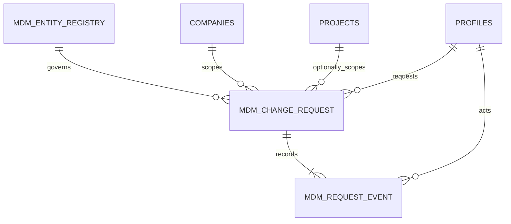

# MDM Phase 1 — Governance Foundation Design

**Status:** Phase 1 implementation and local acceptance complete; hosted promotion verification pending  
**Date:** 2026-10-22  
**Depends on:** [STD-001](DCOS-MDM-STD-001/DCOS-MDM-STD-001.md), [CAT-001](DCOS-MDM-CAT-001/DCOS-MDM-CAT-001.md), [COD-001](DCOS-MDM-COD-001/DCOS-MDM-COD-001.md), [Phase 0 decisions](Phase0-Current-State-and-Decisions.md)

## 1. Phase 1 boundary

Phase 1 establishes a shared, auditable **request and approval foundation**. It does not yet create or mutate Project, WBS, Supplier, Material, or Employee master records. Those domains require adapters and their own approved migration/cutover plans.

An approved request means the governance decision is complete. It does not mean the target master record has changed. A request may move to `applied` only after a domain adapter atomically applies the approved change and records the outcome.

### Current implementation checkpoint

The shared transport schemas and application-level lifecycle guard are in `apps/web/lib/mdm/`. The migration is `supabase/migrations/20261022160000_mdm_governance_foundation.sql`; authenticated API routes are under `apps/web/app/api/mdm/`, and the work queue is at `/dashboard/administration/mdm`. The migration was applied to the running local Supabase database and added to local migration history. PostgreSQL functions are authoritative for persisted state and authorization. The hosted project has not been changed.

The migration seeds CAT-001 metadata disabled per tenant, blocks sensitive identity and unsupported scopes until privacy-aware adapters exist, and does not apply approved requests to domain tables. Project-scoped intake is deliberately rejected: `projects` has no tenant/company ownership column, so existing project membership cannot independently prove that project and tenant match. The local custom token hook is configured for the next local stack start and its claim derivation was checked directly; the current stack was not restarted. Hosted hook registration and Phase 0 owner ratification remain production release gates.

## 2. Design decisions

1. Keep MDM inside the existing Supabase/PostgreSQL modular monolith.
2. Reuse `companies.id` / JWT `tenant_id`, `profiles.id`, `project_members`, `role_permissions`, and `has_permission()`.
3. The entity registry is metadata, not a generic JSON master-record store.
4. Store a request's proposed change as JSONB for workflow flexibility, but validate its shape against a versioned, domain-owned Zod/schema adapter before submission and again before application.
5. Keep workflow events append-only. Request status is a current-state projection; the event stream is its audit history.
6. All transitions occur through database functions that validate permission, scope, status, maker/checker separation, and optimistic concurrency. Clients cannot update status columns directly.
7. An entity without a write adapter can be catalogued and receive tenant-scoped requests, but approval cannot mutate that domain record. Sensitive entity intake is blocked until privacy-aware adapters exist. Initial entities remain `adapter_status = 'not_ready'`.

## 3. Conceptual data model



### `mdm_entity_registry`

Seeded and configuration-controlled registry with: `entity_code` (CAT-001 stable code), display name, classification/scope, owner function, consumer modules, change-request enabled flag, adapter status, schema version, and timestamps. Registry changes require MDM configure permission and an audit event. It SHALL not store arbitrary entity rows or user-provided SQL/schema definitions.

### `mdm_change_requests`

One row per proposed create/change/deactivate/merge operation:

| Attribute | Rule |
|---|---|
| `id` | UUID request ID; generated by database. |
| `tenant_id` | Required for tenant/project scopes; derived from JWT, never accepted as trusted client authority. Nullable only for explicitly platform-scoped reference requests. |
| `project_id` | Optional; required for project-scoped entities and validated against tenant and project membership. |
| `entity_code` | FK to enabled registry entry; request type must be allowed for that entity. |
| `request_type` | `create`, `update`, `deactivate`, or `merge`; domain adapter may narrow allowed types. |
| `target_record_id` | Nullable for create; existing UUID for update/deactivate/merge. No code-based foreign keys. |
| `base_snapshot` | Server-captured current values for a change request; used for review and stale-write detection. Read access redacted by domain policy. |
| `proposed_values` | JSONB payload validated by the adapter schema version; never applied as unchecked column names or SQL. |
| `schema_version` | Validation schema/version used when submitted; application refuses incompatible or stale versions. |
| `reason` | Required, bounded text; mandatory for change, deactivation, and merge. |
| `effective_at` | Optional effective date, required only for domains whose standard supports effective dating. |
| `status` | `draft`, `submitted`, `under_review`, `returned`, `approved`, `apply_failed`, `rejected`, `applied`, or `cancelled`. |
| `requested_by`, timestamps | Actor and lifecycle timestamps set by database transition functions. |
| `decided_by`, `decided_at` | Set only by approval/rejection/return transition; requester cannot decide own request. |
| `applied_at`, `applied_by`, `apply_result` | Set only by the domain adapter after successful atomic application. Result excludes secrets. |
| `created_at`, `updated_at` | Database timestamps. Direct client writes to workflow fields prohibited. |

### `mdm_request_events`

Append-only event rows with request ID, tenant ID, actor/service identity, event type, prior/new status, comment/reason, timestamp, and a redacted JSON diff or safe event payload. RLS allows scoped reads only; ordinary clients receive no update/delete rights. Inserts are performed only by transition/apply functions.

## 4. Lifecycle and transition rules

```text
draft → submitted → under_review → approved → applied
                  ↘ returned → submitted
                  ↘ rejected
approved → apply_failed → approved (retry after the cause is resolved)
draft/submitted/returned → cancelled
```

- Create request: authenticated user has MDM `can_create` for the entity/action and permitted scope.
- Submit: validates registry availability, required reason, transport payload bounds, schema version, and tenant scope. Domain schema, duplicate-search, code-rule, and evidence validation must be registered by the first domain adapters before production use for those domains.
- Review: authorized steward may return with a mandatory reason or route for decision; reviewer cannot alter the request payload silently.
- Approve/reject: requires `approve`/`reject` permission respectively, non-requester actor, current `under_review` state, and a mandatory rejection reason.
- Apply: requires `approved` state, compatible schema version, a configured domain adapter, unchanged base snapshot/version, and an atomic domain transaction. On failure, no domain change is committed; a sanitized failure event is recorded and the request enters `apply_failed`. A retry returns it to `approved` only after the cause is resolved and a new event is recorded.
- Cancel: permitted only before application and requires requester or authorized steward; event records reason.
- Merge: is not enabled in the generic foundation until a domain adapter defines reference rewrites, survivor rules, uniqueness checks, and rollback evidence.

Database transition functions SHALL use row locking or compare-and-swap against the expected current status/version to prevent double approval, stale decisions, and duplicate application. Each transition and event insert SHALL commit in one transaction.

## 5. Permissions

Use existing `role_permissions` rows under module `mdm`; do not add a parallel permission table for v1.

| Resource/action | Permission field | Intended use |
|---|---|---|
| `change_request` / `read` | `view` | Read scoped requests. Requester can read own request; stewards/reviewers need explicit role permission. |
| `change_request` / `request` | `can_create`, `edit`, `submit` | Draft and submit own requests. `edit` applies only before submission/while returned. |
| `change_request` / `decision` | `approve`, `reject` | Approve/reject under-review requests; maker/checker check is independent and mandatory. |
| `entity_registry` / `configure` | `view`, `configure` | Read/configure registry metadata; configuration role only. |
| `request_event` / `audit` | `view`, `export` | View history; export only if explicitly granted and fields are redacted. |

The existing `has_permission()` admin override grants every configured permission to admins. Domain transition functions SHALL still enforce maker/checker separation and tenant/project scope for admins. Owner/steward assignments are role-based in v1; per-record delegation is deferred.

## 6. Tenant and project security

- RLS SHALL be enabled for all three tables.
- Tenant-scoped request reads require `tenant_id = (auth.jwt()->>'tenant_id')::uuid` plus requester ownership or `has_permission('mdm', ..., 'view')`.
- Platform-scope requests require an explicit platform permission; null tenant is not a bypass condition.
- Project-scoped requests must verify `projects.id` belongs to the same tenant and that the actor has project membership or an explicitly authorized company-wide role.
- Request insertion ignores/replaces client-supplied actor and tenant IDs with `auth.uid()` and trusted JWT scope.
- Event reads inherit request scope; no independent event policy may widen access.
- Service-role clients are not used as an authorization substitute in request handlers. If a server service client is needed, the API must authenticate the user and pass the user identity into a security-definer function that rechecks permissions against `auth.uid()`.
- Payload JSON SHALL be redacted by domain adapter before event/audit presentation. Employee/bank/tax fields are not exposed to generic MDM reviewers by default.

## 7. API boundary

Recommended routes:

| Route | Operation |
|---|---|
| `GET /api/mdm/entities` | List entity registry entries visible to the caller. |
| `POST /api/mdm/entities` | Enable/disable tenant request intake with an audited, version-checked admin RPC. |
| `GET /api/mdm/requests` | List scoped requests with filters for status/entity/age. |
| `POST /api/mdm/requests` | Create draft request after Zod validation. |
| `GET /api/mdm/requests/{id}` | Read request and authorized audit history. |
| `PATCH /api/mdm/requests/{id}` | Edit own draft/returned request only; cannot set status or actor fields. |
| `POST /api/mdm/requests/{id}/transition` | Submit, start review, approve, reject, return, or cancel using an expected version. |

Every route authenticates through Supabase, validates request IDs and body schemas, derives scope server-side, and returns stable error codes for authentication, validation, conflict, and persistence failures. Domain duplicate and adapter-specific errors are added with domain adapters. Routes SHALL not accept arbitrary table names or columns.

## 8. Initial UI boundary

Phase 1 UI includes the tenant entity catalogue and request-intake controls, request draft form for enabled entities, tenant-scoped request queue, review/decision actions, proposed-value detail, request event history, and registry toggle history. Database permissions remain authoritative for every action. No active master-record editor is presented; the generic foundation has no domain adapter or apply operation.

## 9. Migration and rollout sequence

1. Before hosted promotion, confirm the deployed schema, custom JWT hook registration, tenant claims, project membership behavior, and role data.
2. Review the migration, which has been applied and verified in the local Supabase database. Apply it to hosted only through the normal database change process after owner approval.
3. Seed CAT-001 metadata disabled for request intake, with all adapters `not_ready`; never apply approved requests to unimplemented domain records.
4. Add API read/list and draft/submit flows; use user-authenticated RPC calls.
5. Add steward queue and approve/reject/return transitions; verify maker/checker and tenant/project isolation.
6. Enable one domain adapter only after its data owner, code rules, source-of-record map, migration, and tests are approved.

No production migration or activation is authorized by this design. Promotion follows the repository's normal database review and deployment procedure.

## 10. Acceptance criteria for Phase 1 foundation

- Registry entries are controlled and do not become a generic master-data JSON store.
- A user can create and submit a valid scoped request; an unauthorized user cannot submit or view another tenant's request.
- The requester cannot approve/reject their own request, including when their role is admin.
- Invalid lifecycle transitions, stale decisions, and repeated submissions are rejected atomically.
- Event history is complete and cannot be updated/deleted by authenticated application users.
- Approval does not mutate domain records without a configured domain adapter.
- Project-scoped requests and platform-reference intake remain unavailable in the foundation migration. Project scope needs a verified tenant-to-project relation; platform scope needs a platform registry/permission model.
- Sensitive fields are redacted or access-restricted in request lists and event history.
- Imports and direct client calls cannot bypass the same permissions and validation.

### Implementation verification status

- Source implementation is present for the tenant-scoped registry, requests, append-only request/registry events, authenticated lifecycle RPCs, API routes, and initial UI.
- The SQL migration is applied in local Supabase and registered in local migration history. Rollback-only local acceptance checks passed for create, submit, review, approval, maker/checker, version guards, append-only audit, sensitive-data rejection, and project-scope rejection.
- Focused ESLint passed for the MDM changes. The app-wide typecheck remains blocked by errors in existing untracked Library UI files; it reported no MDM-file errors. Hosted acceptance has not been run.
- Sensitive entity codes require a privacy-aware adapter before intake can be enabled. Approved requests remain proposals; no domain adapter or apply transition is enabled in Phase 1.
